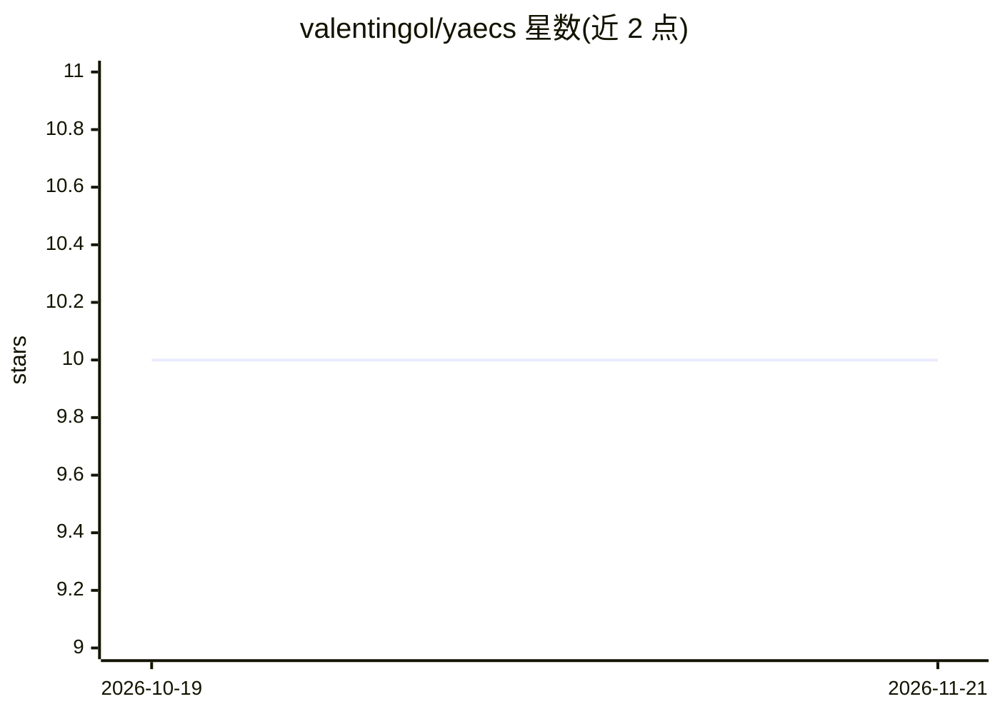

# valentingol/yaecs

⭐ 10 · Python · LGPL-3.0 · 推送 2026-06-11 · [GitHub](https://github.com/valentingol/yaecs) · 个人维护

**面向机器学习实验的配置文件管理系统**

YAECS 是一个 Python 配置管理库，用于以安全、清晰、可复现的方式操作实验配置文件。它将参数从代码中抽出，支持从字典或 YAML 文件创建配置对象，通过命令行解析器在运行时覆盖参数；设计时考虑机器学习实验的约束与可扩展性，声称旧配置可前向兼容、实验可复现。以 PyPI 包形式分发，文档另有链接。

## 筛选速览

| 维度 | 判定 | 备注 |
|---|---|---|
| AI 角色 | `ai-ecosystem` | LLM/agent 周边工具 |
| 许可风险 | `viral` | LGPL-3.0 |
| 部署形态 | `library` | 以包/库形式分发 |
| 模型依赖 | — | README 未给出锁定关系 |
| 硬件要求 | — | 无带数字的原话,不猜 |
| 安装摩擦 | `low` | 无编译、无系统依赖或容器化 |
| 成熟度 | — | 结构信号不足 |

## 能力要点

- 从字典或 YAML 文件创建配置对象，接口兼容字典与属性访问
- 内置命令行解析器，运行时直接覆盖参数
- 为机器学习实验设计，也声明可用于其他类型项目
- 以参数管理为核心，支持大规模多实验项目

## 适用场景

- 把硬编码的实验超参数移出代码，统一用配置文件管理
- 命令行快速修改 batch_size 等少量参数后重跑实验
- 多人协作科研项目中保存与复现历史实验配置

## 场景标签

 · 领域:机器学习开发工具

## 证据(README 行号)

> L12: This package is a Config System which allows easy manipulation of config files for safe, clear and repeatable
> L15: - built for Machine Learning with its constraints in mind, but also usable out-of-the-box for other kinds of projec

## 星数曲线

2026-10-19 10 → 2026-11-21 10（+0）

---
*卡片 v1 · prompt 1.4 · 生成 2026-11-19 · 置信度 mid · 依据 README sha `0304e91c1ad9` · [字段定义](../../DATASET.md)*
