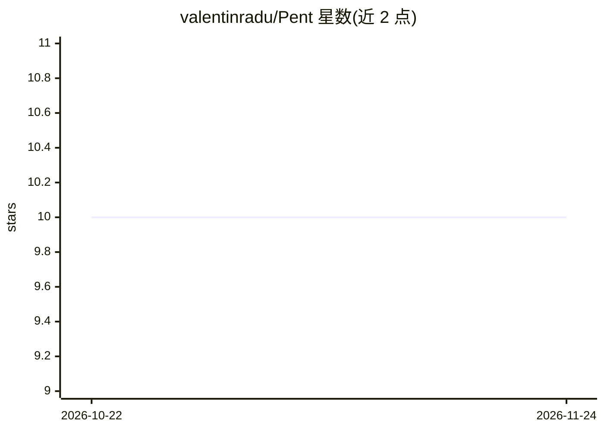

# valentinradu/Pent

⭐ 10 · Rust · MIT · 推送 2026-11-22 · [GitHub](https://github.com/valentinradu/Pent) · 个人维护

**给开发者限制不可信进程文件与网络访问的轻量沙箱**

一个进程沙箱包装器，用操作系统原生机制（macOS Seatbelt、Linux Landlock/overlayfs/namespaces）限制子进程的文件系统与网络访问，无需容器或虚拟机。提供 watch 记录模式：先不沙箱运行一次，记录其用到的文件与域名并生成规则；内置 DNS/TCP 代理按域名白名单过滤出站流量，无需 root。README 明确声明它不是安全工具，只防意外越界，不防蓄意攻击。示例场景为沙箱运行 claude 等 AI 进程。

## 筛选速览

| 维度 | 判定 | 备注 |
|---|---|---|
| AI 角色 | `ai-enhanced` | 去掉 AI 部分产品仍成立 |
| 许可风险 | `permissive` | MIT |
| 部署形态 | `self-host` | docker 或自建部署 |
| 模型依赖 | — | README 未给出锁定关系 |
| 硬件要求 | — | 无带数字的原话,不猜 |
| 安装摩擦 | `low` | 无编译、无系统依赖或容器化 |
| 成熟度 | — | 结构信号不足 |

## 能力要点

- watch 记录模式自动生成文件与域名白名单规则
- Linux 端 Landlock+overlayfs+多 namespace 组合，无需 root
- 内置 DNS/TCP 代理按域名白名单过滤出站流量
- macOS 生成 SBPL 策略经 sandbox-exec 启动子进程

## 适用场景

- 在工作站上沙箱运行不可信的 AI 编码进程
- 限制脚本只能写入指定目录、访问指定域名
- 为构建或测试进程提供文件系统与网络隔离

## 场景标签

 · 领域:安全/系统工具

## 证据(README 行号)

> L6: Wrap any process in a lightweight containment layer that restricts filesystem and network access using native OS mec
> L11: pent watch -- claude
> L17: Pent is for developers who need to run powerful but untrusted processes without giving them unrestricted access to 

## 星数曲线

2026-10-22 10 → 2026-11-24 10（+0）

---
*卡片 v1 · prompt 1.4 · 生成 2026-11-19 · 置信度 mid · 依据 README sha `0a57121f7c82` · [字段定义](../../DATASET.md)*
