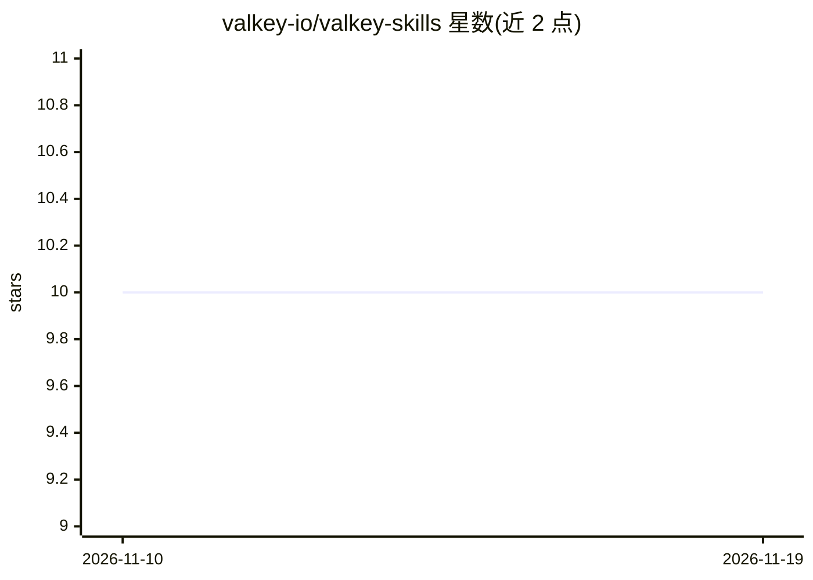

# valkey-io/valkey-skills

⭐ 10 · NOASSERTION · 推送 2026-07-04 · [GitHub](https://github.com/valkey-io/valkey-skills) · 组织维护

**面向 AI 编码代理的 Valkey 领域知识技能包**

为 Valkey 生态编写的 AI 技能仓库，首版提供 valkey 一个应用开发者参考技能：SKILL.md 作为路由器，按触发词将任务定向到 skills/valkey/references/ 下的 32 个主题文件（特性与版本、应用模式、集群与高可用、性能、脚本与安全）。采用 AgentSkills 开放标准格式，可安装到 Claude Code、Codex、Cursor、Cline 等兼容代理。valkey-dev 与 valkey-ops 技能尚在计划中。

## 筛选速览

| 维度 | 判定 | 备注 |
|---|---|---|
| AI 角色 | `ai-knowledge` | 知识聚合/清单类 |
| 许可风险 | `none` | NOASSERTION |
| 部署形态 | `library` | 以包/库形式分发 |
| 模型依赖 | — | README 未给出锁定关系 |
| 硬件要求 | — | 无带数字的原话,不猜 |
| 安装摩擦 | `low` | 无编译、无系统依赖或容器化 |
| 成熟度 | `idea` | |

## 能力要点

- 32 个按用户任务边界拆分的主题文件，由 SKILL.md 路由按需加载
- 遵循 AgentSkills 开放标准，一份技能可在 50+ 代理上使用
- 收录精确默认值、错误字符串、版本门控行为等易错知识点

## 适用场景

- 让编码代理在写 Valkey 客户端代码时按需查阅缓存、锁、限流等模式参考
- 代理需要集群、哨兵、持久化等 Valkey 领域知识时避免通用背景占用上下文
- 对 Valkey 做基准测试时查阅 valkey-benchmark 与 memtier_benchmark 的语法与常见偏差

## 场景标签

`编码 Agent` · 领域:编码与开发

## 证据(README 行号)

> L3: Domain-specific AI skills for the Valkey ecosystem, authored for AI coding agents and developers.
> L5: First release ships one skill: `valkey` - an application-developer reference. Installable into Claude Code, Codex, C
> L9: A skill is a reference the agent loads on demand. `SKILL.md` is a router: trigger phrases and a table of focused top

## 星数曲线

2026-11-10 10 → 2026-11-19 10（+0）

---
*卡片 v1 · prompt 1.4 · 生成 2026-11-19 · 置信度 high · 依据 README sha `0837e6a41bf8` · [字段定义](../../DATASET.md)*
