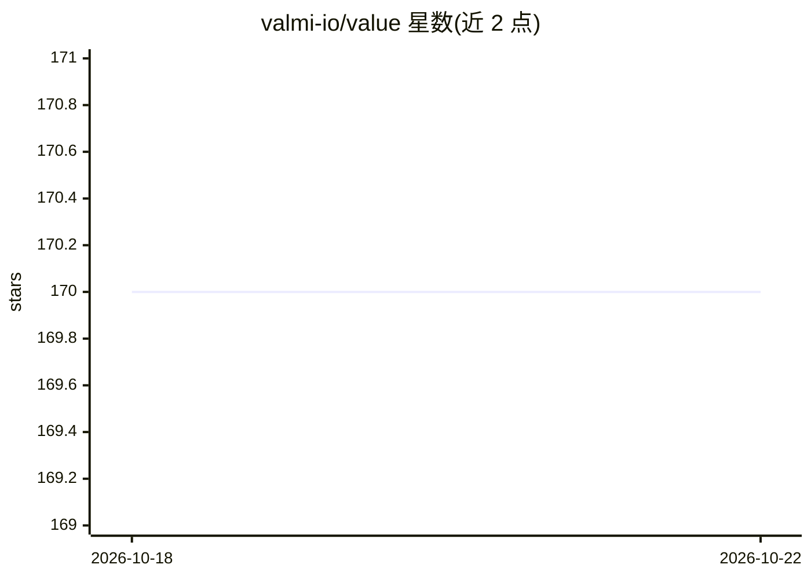

# valmi-io/value

⭐ 170 · Python · NOASSERTION · 推送 2025-12-22 · [GitHub](https://github.com/valmi-io/value) · [官网](https://www.valmi.io) · 组织维护

**AI agent 的用量计量与计费/收益追踪基础设施**

面向 AI agent 开发者的计量、定价与计费平台：通过 Python SDK（value-python）以少量代码追踪 token、LLM 调用、API 用量与产出事件，支持固定费、用量、分层、按动作、按产出等定价组合；自动在 LLM 提供商、API 与计算间分摊成本，并按 agent 与客户维度实时追踪盈利。部署可选 Value Cloud 或 Docker Compose 自托管，自托管包含 Value UI 仪表盘、Control Plane API、Engine 与 Celery 等多个服务。仓库含 Gemini 自动埋点等集成示例。

## 筛选速览

| 维度 | 判定 | 备注 |
|---|---|---|
| AI 角色 | `ai-ecosystem` | LLM/agent 周边工具 |
| 许可风险 | `none` | NOASSERTION |
| 部署形态 | `self-host` | docker 或自建部署 |
| 模型依赖 | — | README 未给出锁定关系 |
| 硬件要求 | — | 无带数字的原话,不猜 |
| 安装摩擦 | `low` | 无编译、无系统依赖或容器化 |
| 成熟度 | — | 结构信号不足 |

## 能力要点

- 追踪 token、LLM 调用、API 用量与产出事件的计量 SDK
- 固定费/用量/分层/按动作/按产出等组合定价
- 跨 LLM 提供商、API 与计算的成本自动分摊
- Docker Compose 自托管，含 UI、Control Plane、Engine 多服务

## 适用场景

- 为 AI agent 产品接入用量计量与灵活计费
- 按客户与 agent 维度追踪盈利（P&L）
- 自托管部署以掌控计量与计费数据

## 场景标签

 · 领域:AI agent 商业化/计费基础设施

## 证据(README 行号)

> L14: Outcome-based billing and payments infrastructure for AI agents. Meter usage, configure flexible pricing, and track
> L20: - **AI-Native Metering** - Track tokens, LLM calls, API usage, and outcomes with minimal code

## 星数曲线

2026-10-18 170 → 2026-10-22 170（+0）

---
*卡片 v1 · prompt 1.4 · 生成 2026-10-22 · 置信度 high · 依据 README sha `41ea6f1ffcf5` · [字段定义](../../DATASET.md)*
