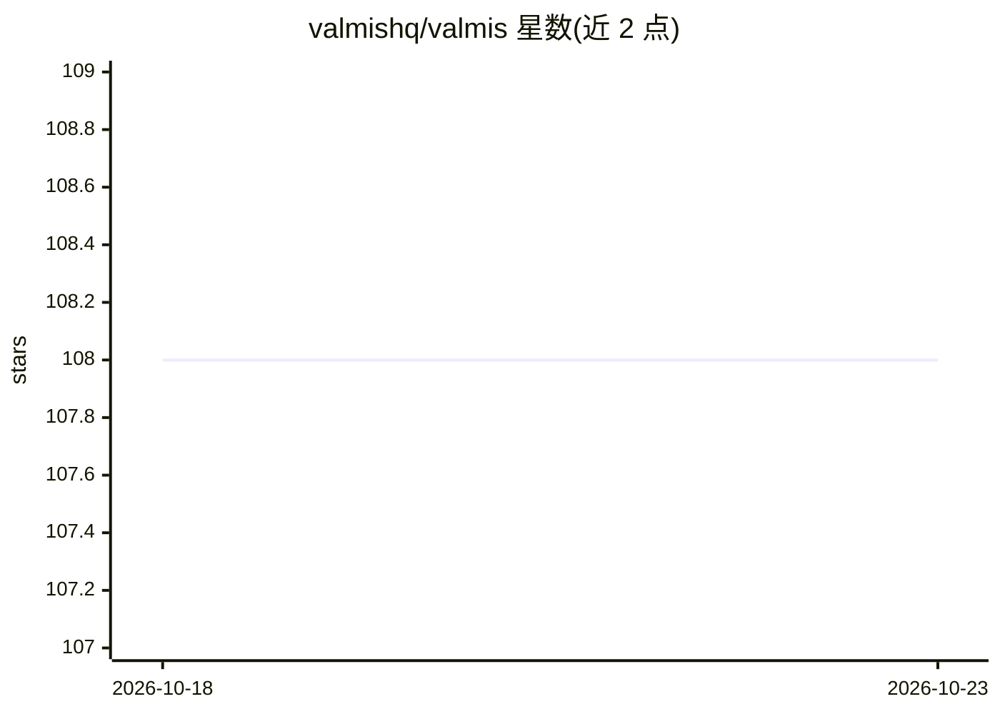

# valmishq/valmis

⭐ 108 · TypeScript · Apache-2.0 · 推送 2026-09-01 · [GitHub](https://github.com/valmishq/valmis) · [官网](https://docs.valm.is) · 组织维护

**面向生产工作的云端 AI Agent 平台，强调安全隔离**

云端 AI Agent 应用：用户可组建 agent 舰队，接入 100+ 业务与生产力集成（Slack、Notion、Salesforce 等），通过聊天或工作流（cron/webhook/应用事件触发）自动化任务。安全机制为核心卖点：agent 运行于隔离容器，凭证以 AES-256-GCM 加密存储，agent 仅通过宿主机代理发起 API 请求，不直接接触凭证或宿主文件，甚至可关闭容器外网。支持跨会话四类记忆（pgvector 语义检索）、多 LLM 提供商（近 200 模型/20 提供商）、浏览器自动化代理、无头浏览器操作。以 Docker Compose 单文件部署，Apache 2.0 许可。

## 筛选速览

| 维度 | 判定 | 备注 |
|---|---|---|
| AI 角色 | `ai-native` | 本体是模型或模型工具 |
| 许可风险 | `permissive` | Apache-2.0 |
| 部署形态 | `self-host` | docker 或自建部署 |
| 模型依赖 | locked-api |  |
| 硬件要求 | — | 无带数字的原话,不猜 |
| 安装摩擦 | `low` | 无编译、无系统依赖或容器化 |
| 成熟度 | — | 结构信号不足 |

## 能力要点

- 代理系统：agent 容器无凭证、无外网仍可经宿主机调用 API
- 100+ 业务集成，每个集成为单个 YAML 定义文件
- 四类记忆（episodic/semantic/procedural/working）持久化，pgvector 语义检索
- 支持近 200 个模型、20 个 LLM 提供商及 OpenRouter

## 适用场景

- 在生产环境安全地运行连接企业应用的 AI agent
- 用 cron/webhook/应用事件自动执行多步工作流
- 组建分工协作的 agent 舰队处理业务流程

## 场景标签

 · 领域:AI Agent/自动化平台

## 证据(README 行号)

> L3: Valmis is a cloud-based application for shipping AI agents for production work. It allows you to build a fleet of ag
> L5: Valmis is designed to automate workflows using AI. You can interact with your agent using the chat interface, or ask
> L109: - **Use any LLM provider:** You can connect to any LLM provider and use their chat or embedding models flexibly. W

## 星数曲线

2026-10-18 108 → 2026-10-23 108（+0）

---
*卡片 v1 · prompt 1.4 · 生成 2026-10-23 · 置信度 high · 依据 README sha `69d923f2d0ad` · [字段定义](../../DATASET.md)*
