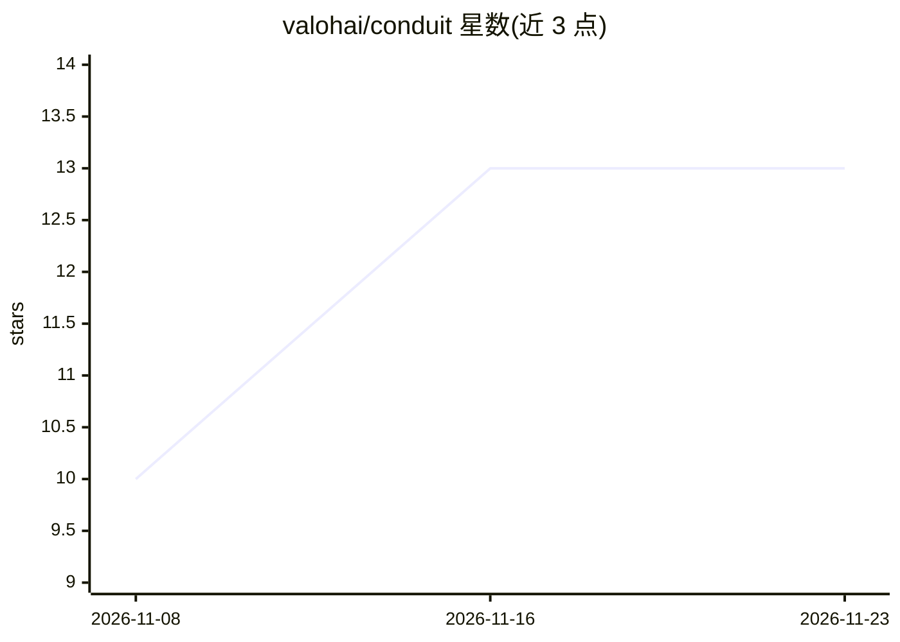

# valohai/conduit

⭐ 13 · Rust · MIT · 推送 2026-11-19 · [GitHub](https://github.com/valohai/conduit) · [官网](https://docs.valohai.com/) · 组织维护

**本地 LLM API 代理：拦截调用并记录各供应商 token 用量与成本**

用 Rust 编写的单二进制本地代理，部署在代码与 LLM API 供应商之间：将 SDK 的 base URL 指向 Conduit 即可拦截 API 调用并逐次记录 token 消耗与成本，无需改代码。费用按内置的 OpenAI 与 Anthropic 模型价格表估算，其他模型可在 conduit.toml 的 [pricing] 表自定义费率，含缓存读写与长提示加价规则；调用记录写入本地 SQLite，终端 UI 面板查看每次调用的 token 与成本，也可发送到 Valohai LLM 做进一步成本分析。MIT 许可，经安装脚本、GitHub Releases 预编译二进制或 cargo 安装。

## 筛选速览

| 维度 | 判定 | 备注 |
|---|---|---|
| AI 角色 | `ai-ecosystem` | LLM/agent 周边工具 |
| 许可风险 | `permissive` | MIT |
| 部署形态 | `library` | 以包/库形式分发 |
| 模型依赖 | — | README 未给出锁定关系 |
| 硬件要求 | — | 无带数字的原话,不猜 |
| 安装摩擦 | `low` | 无编译、无系统依赖或容器化 |
| 成熟度 | — | 结构信号不足 |

## 能力要点

- 单二进制本地代理，拦截 API 调用记录 token 与成本，零代码改动
- 内置 OpenAI/Anthropic 价格表，支持 [pricing] 自定义模型费率与缓存、长提示定价
- 调用记录存 SQLite，终端 UI 面板逐次查看用量
- 无总时长限制的长流式响应支持，可配置连接/空闲超时

## 适用场景

- 本地开发时统计各 SDK 调用的 token 消耗与费用
- 同时接入多个 LLM API 供应商并统一记录用量
- 自定义私有模型的计费费率做成本估算

## 场景标签

`LLM 可观测性` · 领域:评测与运维

## 证据(README 行号)

> L5: Conduit is a local proxy that sits between your code and LLM providers
> L14: - run a proxy locally to intercept API calls
> L16: - view the token consumption of each API call in a terminal UI

## 星数曲线

2026-11-08 10 → 2026-11-23 13（+3）

---
*卡片 v1 · prompt 1.4 · 生成 2026-11-18 · 置信度 high · 依据 README sha `dd812b70b50d` · [字段定义](../../DATASET.md)*
