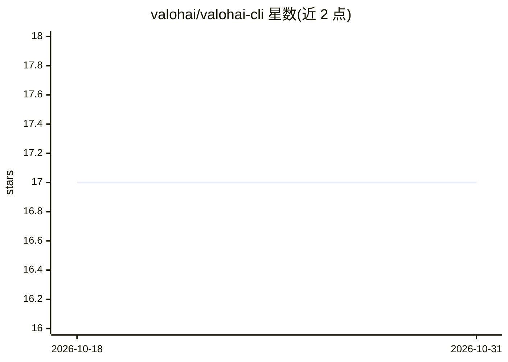

# valohai/valohai-cli

⭐ 17 · Python · MIT · 推送 2026-08-18 · [GitHub](https://github.com/valohai/valohai-cli) · 组织维护

**Valohai 机器学习平台的命令行客户端**

Valohai（机器学习 IaaS 平台）的命令行客户端，安装后提供 vh 命令，用于与平台交互。支持 Python 3.10 及以上，历史上各版本对应旧 Python 版本支持；推荐通过 pipx 隔离安装，也可用 pip 系统级安装或虚拟环境安装，开发时用 make dev 以可编辑模式链接源码。面向使用 Valohai 平台进行机器学习实验管理的开发者和团队。

## 筛选速览

| 维度 | 判定 | 备注 |
|---|---|---|
| AI 角色 | `ai-ecosystem` | LLM/agent 周边工具 |
| 许可风险 | `permissive` | MIT |
| 部署形态 | `library` | 以包/库形式分发 |
| 模型依赖 | — | README 未给出锁定关系 |
| 硬件要求 | — | 无带数字的原话,不猜 |
| 安装摩擦 | `low` | 无编译、无系统依赖或容器化 |
| 成熟度 | — | 结构信号不足 |

## 能力要点

- 提供 vh 命令行入口与平台交互
- 推荐 pipx 隔离安装，避免依赖冲突
- 支持 pip 系统级与虚拟环境两种安装方式
- 开发流程提供 make dev/lint/test 命令

## 适用场景

- 通过命令行操作 Valohai 机器学习平台
- 在隔离环境中安装和升级客户端
- 以可编辑模式开发调试客户端本身

## 场景标签

`MLOps` · 领域:训练与推理

## 证据(README 行号)

> L8: This is the command-line client for the [Valohai][vh] machine learning IaaS platform.
> L64: After you've installed the client, `vh` should work and you should see a description

## 星数曲线

2026-10-18 17 → 2026-10-31 17（+0）

---
*卡片 v1 · prompt 1.4 · 生成 2026-10-29 · 置信度 high · 依据 README sha `884e554cdbe1` · [字段定义](../../DATASET.md)*
