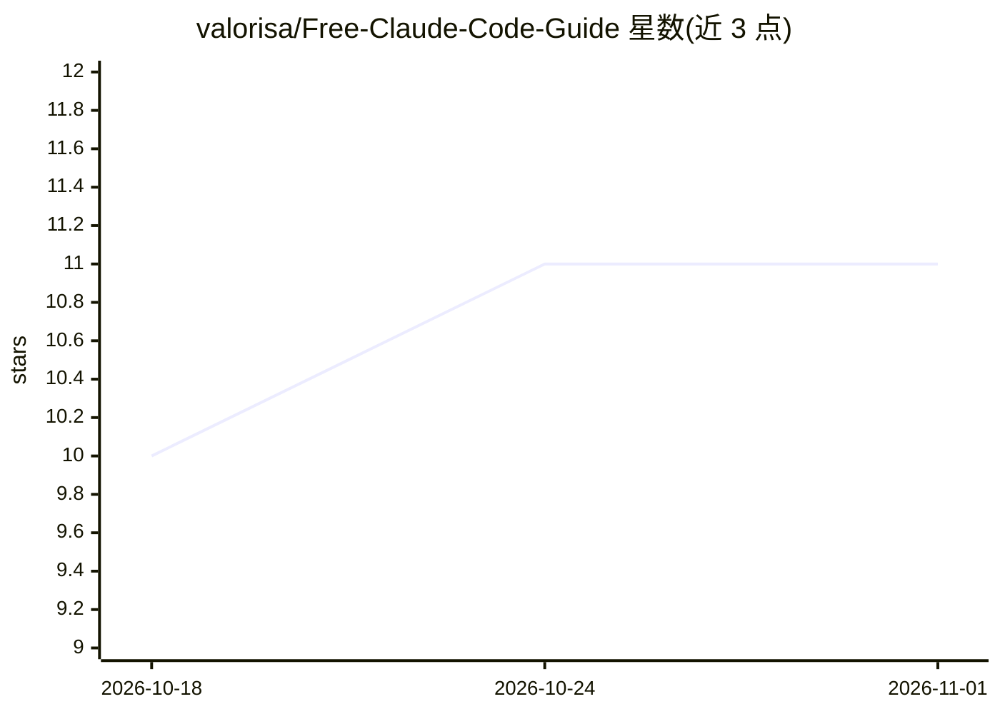

# valorisa/Free-Claude-Code-Guide

⭐ 11 · Dockerfile · MIT · 推送 2026-05-04 · [GitHub](https://github.com/valorisa/Free-Claude-Code-Guide) · 个人维护

**Free Claude Code 代理的安装使用指南文档（Windows/macOS/Linux）**

面向使用者的法文操作手册，记录在 macOS Sequoia 与 VSCode 上完整安装 Free Claude Code 代理的过程。该代理拦截 Claude Code 发出的 Anthropic API 请求并转发至 NVIDIA NIM、OpenRouter、DeepSeek 等 provider，将 Opus/Sonnet/Haiku 虚拟层级路由到 GLM-4.7、Kimi K2 等模型。指南覆盖 uv 与 Python 3.14 安装、企业代理配置、.env 六种 provider 配置、模型路由说明与防火墙端口设置。本仓库本身为文档，代理来自另一仓库 Alishahryar1/free-claude-code。

## 筛选速览

| 维度 | 判定 | 备注 |
|---|---|---|
| AI 角色 | `ai-knowledge` | 知识聚合/清单类 |
| 许可风险 | `permissive` | MIT |
| 部署形态 | `None` |  |
| 模型依赖 | locked-api |  |
| 硬件要求 | — | 无带数字的原话,不猜 |
| 安装摩擦 | `low` | 无编译、无系统依赖或容器化 |
| 成熟度 | — | 结构信号不足 |

## 能力要点

- 按 Windows/macOS/Linux 三平台分别给出安装步骤与注意事项
- 解释 Opus/Sonnet/Haiku 虚拟层级到真实模型的路由机制
- 覆盖企业出站代理、Gatekeeper、防火墙端口等环境细节
- 提供 .env 配置项说明（provider 选择、限流、thinking 开关）

## 适用场景

- 照步骤在本机搭建 Free Claude Code 代理并用 Claude Code CLI
- 选择 OpenRouter 或 NVIDIA NIM 作为免费 provider 并配置模型路由
- 排查企业代理、杀毒软件、防火墙导致的安装问题

## 场景标签

`教程课程` · 领域:学习与行业

## 证据(README 行号)

> L11: > **IMPORTANT** : Ce guide est un "pense-bête" exhaustif créé après une session d'installation complète sur macOS S
> L169: **Free Claude Code** (dépôt : `Alishahryar1/free-claude-code`) est un **proxy**. Il redirige les appels API d'Anth

## 星数曲线

2026-10-18 10 → 2026-11-01 11（+1）

---
*卡片 v1 · prompt 1.4 · 生成 2026-11-01 · 置信度 mid · 依据 README sha `16a8cb702332` · [字段定义](../../DATASET.md)*
