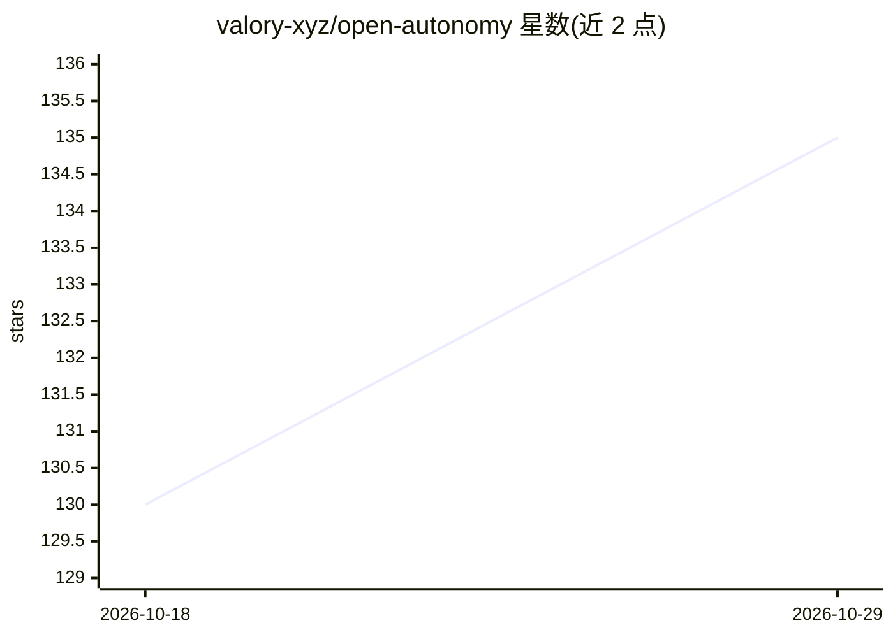

# valory-xyz/open-autonomy

⭐ 135 · Python · Apache-2.0 · 推送 2026-10-26 · [GitHub](https://github.com/valory-xyz/open-autonomy) · [官网](https://stack.olas.network/open-autonomy/) · 组织维护

**构建去中心化链上自主 AI agent 服务的开发框架**

Open Autonomy 是用于创建链下自主 AI agent 的框架：agent 以多智能体系统（MAS）形式运行，并在链上提供功能扩展，可执行包括机器学习算法在内的复杂操作，框架称其 agent 具备去中心化、信任最小化、透明与健壮的特性。面向构建链上/链下结合 agent 服务的开发者，基于 Open AEA 生态，开发者贡献路径需安装 Python、Tendermint、IPFS 节点、Go、Docker 等一系列依赖并从源码克隆运行，也通过 PyPI 分发。

## 筛选速览

| 维度 | 判定 | 备注 |
|---|---|---|
| AI 角色 | `ai-ecosystem` | LLM/agent 周边工具 |
| 许可风险 | `permissive` | Apache-2.0 |
| 部署形态 | `self-host` | docker 或自建部署 |
| 模型依赖 | — | README 未给出锁定关系 |
| 硬件要求 | — | 无带数字的原话,不猜 |
| 安装摩擦 | `low` | 无编译、无系统依赖或容器化 |
| 成熟度 | — | 结构信号不足 |

## 能力要点

- 以多智能体系统形式运行链下自主 AI agent，在链上提供服务
- 支持执行包括机器学习算法在内的任意复杂操作
- 通过 PyPI 分发，并提供 docker 预构建镜像用于开发
- 提供包同步命令 autonomy packages sync 管理组件

## 适用场景

- 开发运行在去中心化网络上的多智能体服务
- 扩展智能合约能力，执行复杂链下计算
- 基于加密货币/区块链场景构建自主 agent 应用

## 场景标签

`Agent 框架` `多智能体` · 领域:Agent 开发

## 证据(README 行号)

> L38: **Open Autonomy** is a framework for the creation of **AI agents**: off-chain
> L39: autonomous AI agents which run as a multi-agent-system (MAS) and offer enhanced functionalities
> L40: on-chain. AI agents expand the range of operations that traditional

## 星数曲线

2026-10-18 130 → 2026-10-29 135（+5）

---
*卡片 v1 · prompt 1.4 · 生成 2026-10-22 · 置信度 high · 依据 README sha `2a5226ee4934` · [字段定义](../../DATASET.md)*
