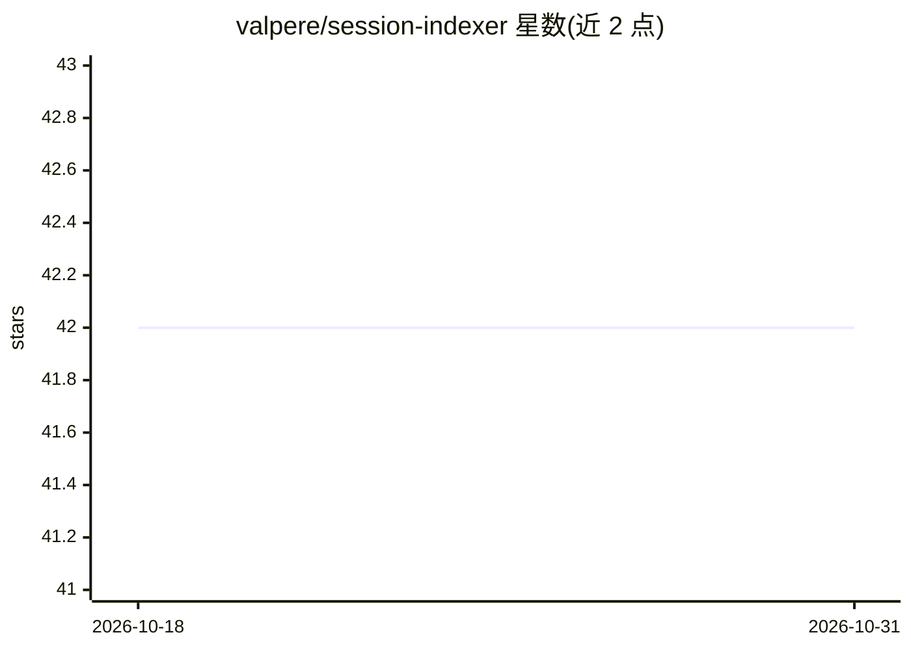

# valpere/session-indexer

⭐ 42 · Go · Apache-2.0 · 推送 2026-10-26 · [GitHub](https://github.com/valpere/session-indexer) · [官网](https://valpere.github.io/projects/session-indexer/) · 个人维护

**对个人 Claude Code 会话历史做项目内语义检索的 CLI 工具**

面向单一开发者、单机的 Go CLI：把 Claude Code 的 JSONL 会话记录增量索引进项目内 .claude/sessions.db（SQLite，append-only，mine 幂等可重建），检索用 bge-m3 嵌入（经 Ollama，localhost:11434），无嵌入时回退 FTS5 BM25；通过 Stop hooks 在会话结束时自动索引，并在会话开始时注入相关历史上下文。另有手动触发的 distill/facts 层，用 LLM 从 chunk 中抽取主谓宾事实，带 --context-cap/--batch 成本控制。范围明确限定为个人非团队共享；git worktree 会拆分 DB 为已知限制。依赖 Go 1.26.9+ 构建，jq 用于 hooks。

## 筛选速览

| 维度 | 判定 | 备注 |
|---|---|---|
| AI 角色 | `ai-ecosystem` | LLM/agent 周边工具 |
| 许可风险 | `permissive` | Apache-2.0 |
| 部署形态 | `library` | 以包/库形式分发 |
| 模型依赖 | local-ok | 支持本地模型 |
| 硬件要求 | — | 无带数字的原话,不猜 |
| 安装摩擦 | `low` | 无编译、无系统依赖或容器化 |
| 成熟度 | — | 结构信号不足 |

## 能力要点

- JSONL 会话增量索引到项目内 SQLite，mine 幂等可重建
- bge-m3（Ollama）向量检索，无嵌入时回退 FTS5 BM25
- Stop hooks 自动索引并在会话开始注入相关历史上下文
- distill/facts 层抽取主谓宾事实，带 --context-cap/--batch 成本调节

## 适用场景

- 回到一周未碰的项目时按语义查找历史会话中的决策
- 在会话开始时自动获得相关历史上下文
- 把跨多个会话的讨论按语义相似度检索而非 grep

## 场景标签

`语义搜索` `Agent 记忆` · 领域:Agent 开发

## 证据(README 行号)

> L6: Per-project semantic search over Claude Code session history. Indexes JSONL
> L7: transcripts into a per-project SQLite store; retrieves via bge-m3 embeddings
> L8: (Ollama) with FTS5 BM25 fallback. Automatically injects relevant past context

## 星数曲线

2026-10-18 42 → 2026-10-31 42（+0）

---
*卡片 v1 · prompt 1.4 · 生成 2026-10-25 · 置信度 high · 依据 README sha `bfb568662e0e` · [字段定义](../../DATASET.md)*
