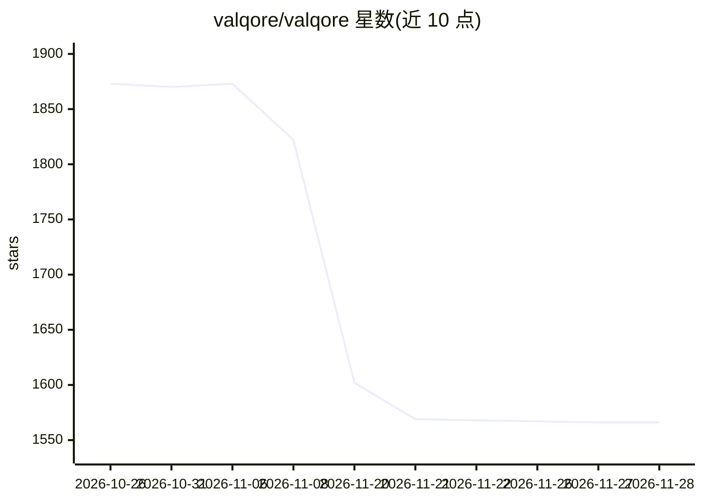

# valqore/valqore

⭐ 1,566 · Python · NOASSERTION · 推送 2026-11-23 · [GitHub](https://github.com/valqore/valqore) · [官网](https://www.valqore.io) · 组织维护

**扫描 K8s/Terraform/云资源的基础设施治理引擎，输出评分与放行/拦截裁决**

基础设施治理引擎：扫描 Kubernetes 清单、Terraform 配置与云资源，按 1,431 条内置规则与 19 个合规包返回 0-100 评分和 PASS/BLOCK 裁决，覆盖安全、成本（FinOps）、碳排（GreenOps）、合规与 AI 治理。核心确定性引擎免密钥免费运行，仅需 Docker；AI 扫描、自然语言对话等功能需授权的独立镜像，内嵌离线模型。提供五种运行面：CLI/Docker、Helm 安装的 K8s 准入控制、VS Code 与 Freelens 扩展、以及 137 个治理工具的 MCP 接口。

## 筛选速览

| 维度 | 判定 | 备注 |
|---|---|---|
| AI 角色 | `ai-enhanced` | 去掉 AI 部分产品仍成立 |
| 许可风险 | `none` | NOASSERTION |
| 部署形态 | `self-host` | docker 或自建部署 |
| 模型依赖 | — | README 未给出锁定关系 |
| 硬件要求 | — | 无带数字的原话,不猜 |
| 安装摩擦 | `low` | 无编译、无系统依赖或容器化 |
| 成熟度 | — | 结构信号不足 |

## 能力要点

- 1,431 条规则、19 个合规包（含 EU AI Act、OWASP Agentic、HIPAA、SOC2 等）
- K8s 原生 8 个 ValidatingAdmissionPolicy 准入控制，引擎不在数据路径上
- agent-audit/agent-gate 对 AI agent 治理姿态打分并拦截变更，可导出 OSCAL
- GreenOps：77 个云区域电网碳强度数据、CO2e 估算与碳预算

## 适用场景

- CI 流水线中对部署清单做安全/成本/合规门禁
- K8s 集群准入时拦截不合规的 AI agent 工作负载
- PR 阶段阻止超出预算基线的基础设施变更
- 为审计准备 HIPAA/ISO 等合规证据包

## 场景标签

 · 领域:DevOps/云基础设施治理

## 证据(README 行号)

> L11: Valqore is an infrastructure governance engine that scans Kubernetes manifests, Terraform configurations, and cloud
> L84: - **AI Scan** — one command runs evaluate + drift detection + AI-powered explanation. The AI image includes a fine-
> L98: |`ghcr.io/valqore/engine:latest`|**Free, public, tokenless**|All 1,431 rules, scoring, drift, billing, compliance, 

## 星数曲线

2026-10-26 1,873 → 2026-11-28 1,566（-307）

---
*卡片 v1 · prompt 1.4 · 生成 2026-11-24 · 置信度 high · 依据 README sha `cacda50ade1e` · [字段定义](../../DATASET.md)*
