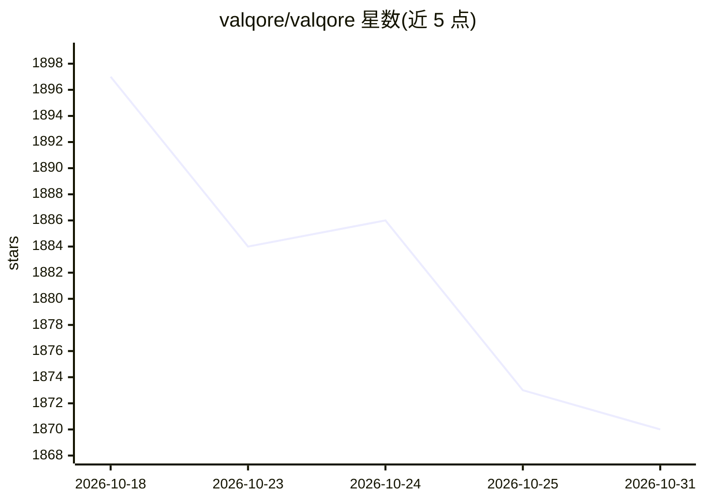

# valqore/valqore

⭐ 1,870 · Python · NOASSERTION · 推送 2026-09-05 · [GitHub](https://github.com/valqore/valqore) · [官网](https://www.valqore.io) · 组织维护

**面向 Kubernetes 与云资源的基础设施治理引擎，输出评分与准入裁决**

扫描 Kubernetes 清单、Terraform 配置与云资源，按 1,431 条内置规则（覆盖安全、成本、碳排、合规、AI 治理，组织为 19 个合规包）输出 0-100 评分与 PASS/PASS_WITH_MONITORING/BLOCK 裁决。提供 agent-audit（对 AI agent 舰队按五维评分）、agent-gate（拦截 agent 变更）、ai-gate（AI 工作负载上线门禁）、FinOps 成本门与 GreenOps 碳排追踪等命令。面向平台工程与合规团队，以 Docker 镜像、Helm chart、VS Code/Freelens 扩展及 MCP 接口提供；确定性核心免费，AI 功能（离线模型、聊天）需许可的付费镜像，代码不开源（镜像为编译后的原生代码）。

## 筛选速览

| 维度 | 判定 | 备注 |
|---|---|---|
| AI 角色 | `ai-enhanced` | 去掉 AI 部分产品仍成立 |
| 许可风险 | `none` | NOASSERTION |
| 部署形态 | `self-host` | docker 或自建部署 |
| 模型依赖 | — | README 未给出锁定关系 |
| 硬件要求 | — | 无带数字的原话,不猜 |
| 安装摩擦 | `low` | 无编译、无系统依赖或容器化 |
| 成熟度 | — | 结构信号不足 |

## 能力要点

- 1,431 条内置规则、19 个合规包（含 EU AI Act、OWASP Agentic、HIPAA 等）
- agent-audit/agent-gate：AI agent 舰队治理评分与变更拦截，可导出 OSCAL 审计证据
- K8s 原生准入控制：8 个 ValidatingAdmissionPolicy 由 API server 执行，引擎不在数据路径
- GreenOps 碳排追踪：77 个云区域的电网碳强度数据

## 适用场景

- 在 CI/PR 中对清单与 Terraform 做安全和成本门禁
- 审计集群中运行的 AI agent 的治理状况
- 生成 HIPAA/SOC2/EU AI Act 等合规证据包
- 按碳预算与成本增量门禁管理云支出

## 场景标签

 · 领域:云基础设施治理/DevOps

## 证据(README 行号)

> L11: Valqore is an infrastructure governance engine that scans Kubernetes manifests, Terraform configurations, and cloud
> L84: - **AI Scan** — one command runs evaluate + drift detection + AI-powered explanation. The AI image includes a fine-
> L92: deterministic core — it's free and runs tokenless. The public image is **compiled** (native

## 星数曲线

2026-10-18 1,897 → 2026-10-31 1,870（-27）

---
*卡片 v1 · prompt 1.4 · 生成 2026-10-21 · 置信度 high · 依据 README sha `6458f3292729` · [字段定义](../../DATASET.md)*
