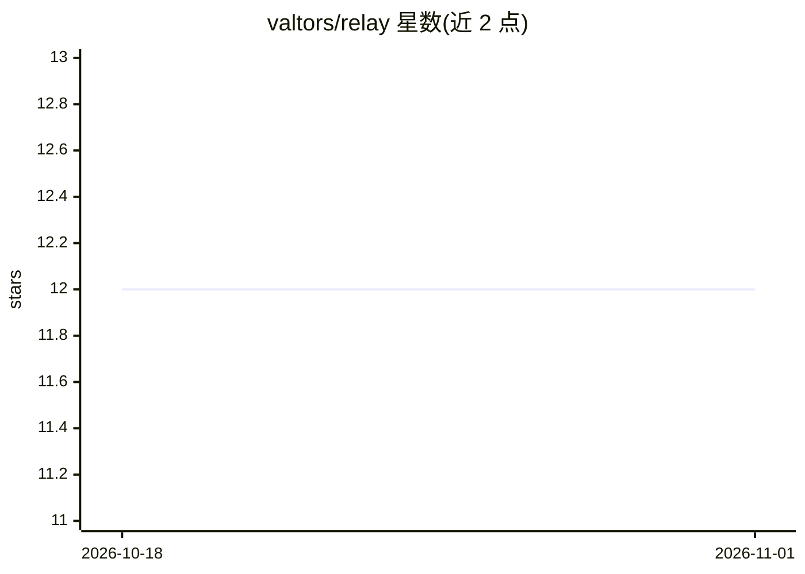

# valtors/relay

⭐ 12 · Go · MIT · 推送 2026-10-31 · [GitHub](https://github.com/valtors/relay) · [官网](https://valtors.github.io/relay) · 个人维护

**单一 Go 二进制的 MCP 服务器：40 个工具供 AI agent 调用**

面向 MCP 客户端（Claude Desktop、Cursor、VS Code 等）的本地 MCP 服务器，以单个 Go 二进制提供 7 类共 40 个工具：文件读写/压缩、图像处理、PDF 提取与合并拆分、网页抓取、CSV/JSON/base64 转换，以及 8 个工作流规划工具（后者需配置 ANTHROPIC_API_KEY 才启用）。默认 stdio 传输，可用 --http 切换；通过 npx userelay 启动安装向导、检测编辑器并写入配置，文件保留在本地、无遥测。多数工具无需 API key。

## 筛选速览

| 维度 | 判定 | 备注 |
|---|---|---|
| AI 角色 | `ai-ecosystem` | LLM/agent 周边工具 |
| 许可风险 | `permissive` | MIT |
| 部署形态 | `library` | 以包/库形式分发 |
| 模型依赖 | locked-api |  |
| 硬件要求 | — | 无带数字的原话,不猜 |
| 安装摩擦 | `low` | 无编译、无系统依赖或容器化 |
| 成熟度 | — | 结构信号不足 |

## 能力要点

- 单一二进制内含 7 类 40 个工具（文件/图像/PDF/文本/数据/网页/工作流）
- npx userelay 一条命令完成安装、编辑器检测与 MCP 配置写入
- 默认 stdio、支持 --http 传输；提供交互式 TUI 菜单
- 内置工作流工具在存在 ANTHROPIC_API_KEY 时启用

## 适用场景

- 为 Claude Desktop/Cursor/VS Code 配一个工具齐全的 MCP 服务器
- 让 agent 在本地完成读 PDF、改图片、抓网页、转格式等工作
- 用一条命令替代拼装多个单用途 MCP 服务器

## 场景标签

`网页抓取` `图像视频处理` `文档解析` · 领域:效率与自动化

## 证据(README 行号)

> L5: **One MCP server for files, images, PDFs, web, and workflows.** Your files stay local. No telemetry. No account. No 
> L62: - Runs one MCP server with 40 tools across 7 categories.
> L68: - Works with Claude Desktop, Cursor, VS Code, and other MCP clients.

## 星数曲线

2026-10-18 12 → 2026-11-01 12（+0）

---
*卡片 v1 · prompt 1.4 · 生成 2026-10-31 · 置信度 high · 依据 README sha `3e424b17ddfe` · [字段定义](../../DATASET.md)*
