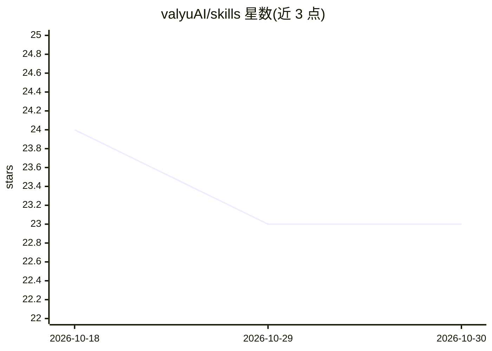

# valyuAI/skills

⭐ 23 · JavaScript · 推送 2026-01-21 · [GitHub](https://github.com/valyuAI/skills) · [官网](https://skills.sh/valyuai/skills/valyu-best-practices) · 组织维护

**让 AI agent 接入 Valyu 检索 API 的技能包**

遵循 Agent Skills 规范的技能仓库，当前提供 valyu-search 一个技能，指导 AI agent 调用 Valyu 统一 API：跨 25+ 数据源（网页、学术、金融、医疗、经济、新闻、预测市场、专利等）检索、URL 内容提取为 markdown、带引用的 AI 回答与深度研究报告（fast/standard/heavy 三档时长）。通过 npx skills add 安装到 Claude Code 等 agent 平台，开发者可另用官方 JS/Python SDK 集成，需 Valyu API key（含 $10 免费额度）。

## 筛选速览

| 维度 | 判定 | 备注 |
|---|---|---|
| AI 角色 | `ai-ecosystem` | LLM/agent 周边工具 |
| 许可风险 | `none` | — |
| 部署形态 | `library` | 以包/库形式分发 |
| 模型依赖 | — | README 未给出锁定关系 |
| 硬件要求 | — | 无带数字的原话,不猜 |
| 安装摩擦 | `low` | 无编译、无系统依赖或容器化 |
| 成熟度 | — | 结构信号不足 |

## 能力要点

- valyu-search 技能覆盖搜索、内容提取、AI 回答、深度研究四类 API
- 检索范围含 arXiv/PubMed 等学术源、SEC 金融数据、临床与药物数据等 25+ 来源
- 提供 Claude/OpenAI/Vercel AI SDK/LangChain/LlamaIndex/MCP 六份集成指南
- 附搜索/内容/回答/深度研究四类调用配方（Recipes）

## 适用场景

- 给 Claude Code 等 agent 添加跨领域实时检索能力
- 让 agent 从学术论文、SEC 文件、临床数据等来源获取信息
- 通过 DeepResearch API 让 agent 生成综合研究报告

## 场景标签

`语义搜索` `科研工具` · 领域:知识与检索

## 证据(README 行号)

> L3: Agent skills for integrating Valyu APIs into AI agents and assistants.
> L25: |valyu-search|Complete Valyu API toolkit - search, content extraction, AI answers, deep research|

## 星数曲线

2026-10-18 24 → 2026-10-30 23（-1）

---
*卡片 v1 · prompt 1.4 · 生成 2026-10-27 · 置信度 mid · 依据 README sha `fd45d64f7b52` · [字段定义](../../DATASET.md)*
