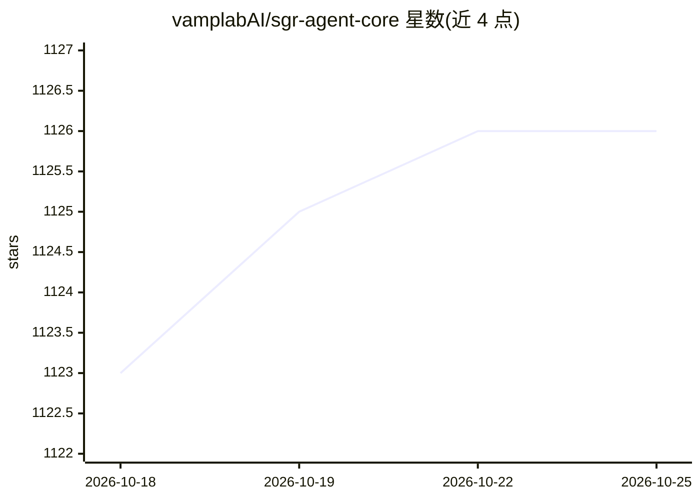

# vamplabAI/sgr-agent-core

⭐ 1,127 · Python · MIT · 推送 2026-09-16 · [GitHub](https://github.com/vamplabAI/sgr-agent-core) · [官网](https://vamplabai.github.io/sgr-agent-core/) · 组织维护

**构建 Schema-Guided Reasoning 研究 agent 的开源框架**

基于 Schema-Guided Reasoning（SGR）理念的开源 agentic 框架：提供可扩展的 BaseAgent 接口（两阶段架构）及 SGRAgent、ToolCallingAgent 等多种现成 agent，内置搜索、推理、澄清工具与实时流式响应，并通过 DeepSearch 服务提供 OpenAI 兼容 REST API，可配合任意 OpenAI 兼容 LLM（含本地模型）使用。以 Python 库形式分发（核心依赖仅 pydantic/PyYAML/openai/httpx，MCP、Tavily 搜索、server 等为可选 extras），带 CLI（sgrsh）、ACP stdio 客户端（sgracp）与 Docker 部署方式。由 neuraldeep 社区开发。

## 筛选速览

| 维度 | 判定 | 备注 |
|---|---|---|
| AI 角色 | `ai-ecosystem` | LLM/agent 周边工具 |
| 许可风险 | `permissive` | MIT |
| 部署形态 | `library` | 以包/库形式分发 |
| 模型依赖 | — | README 未给出锁定关系 |
| 硬件要求 | — | 无带数字的原话,不猜 |
| 安装摩擦 | `low` | 无编译、无系统依赖或容器化 |
| 成熟度 | — | 结构信号不足 |

## 能力要点

- BaseAgent 两阶段架构与多种 agent 类型（SGRAgent/ToolCallingAgent/SGRToolCallingAgent）
- OpenAI 兼容 REST API 与 SSE 流式响应，可作为 OpenAI 端点的直接替换
- 支持任意 OpenAI 兼容 LLM，包括本地模型实现私有化研究
- 可选集成：MCP、Tavily 搜索、HTTP server、ACP、Langfuse

## 适用场景

- 构建可定制工具调用的深度研究 agent
- 通过 OpenAI 兼容 API 为现有应用提供 agent 服务
- 在编辑器中经 Agent Client Protocol (stdio) 运行 SGR agent
- 用本地模型做全私有化的研究问答

## 场景标签

`Agent 框架` `科研工具` · 领域:Agent 开发

## 证据(README 行号)

> L5: Open-source agentic framework for building intelligent research agents using Schema-Guided Reasoning. The project pr
> L7: The library includes extensible tools for search, reasoning, and clarification, real-time streaming responses, OpenA

## 星数曲线

2026-10-18 1,123 → 2026-10-25 1,126（+3）

---
*卡片 v1 · prompt 1.4 · 生成 2026-10-21 · 置信度 high · 依据 README sha `4df6b6f568c9` · [字段定义](../../DATASET.md)*
