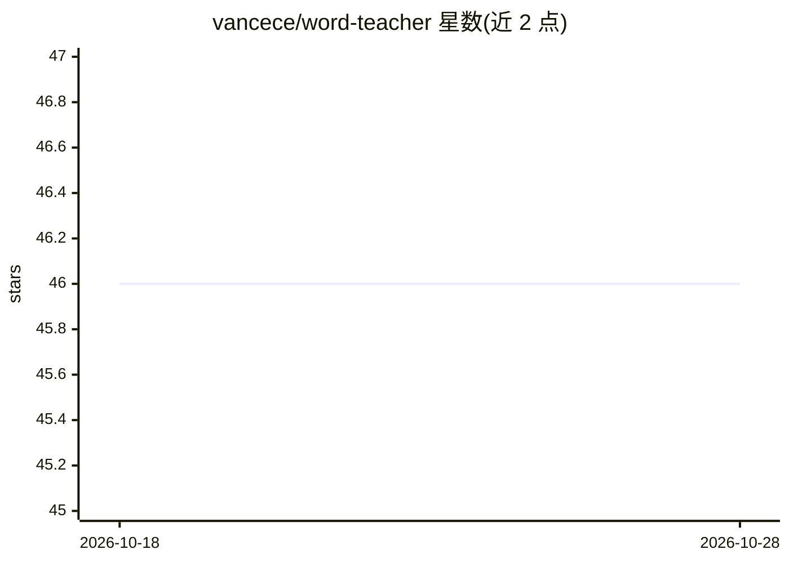

# vancece/word-teacher

⭐ 46 · TypeScript · MIT · 推送 2026-07-09 · [GitHub](https://github.com/vancece/word-teacher) · 个人维护 · 中文 README

**面向英语学习者的 AI 口语训练 Web 应用（对话+跟读+游戏）**

全栈 Web 应用：学生端提供 AI 对话练习（Qwen-Omni 多模态、5 轮对话自动评分）、跟读朗读评分（4 维度 1-5 星、讯飞 ISE 评测）、4 种单词小游戏；教师/管理员后台提供班级学生管理、场景与词包管理、进步追踪，以及基于向量知识库与 MCP 工具的 AI 助手（自然语言查数据、Excel 导出、图表可视化）。技术栈为 React 19 + Node.js/Express + Prisma/MySQL，AI 服务依赖阿里云 DashScope（Qwen-Omni/Qwen-Plus/Paraformer/CosyVoice），需配置 DASHSCOPE_API_KEY，支持 Docker 与 GitHub Actions 蓝绿部署、钉钉通知集成。

## 筛选速览

| 维度 | 判定 | 备注 |
|---|---|---|
| AI 角色 | `ai-native` | 本体是模型或模型工具 |
| 许可风险 | `permissive` | MIT |
| 部署形态 | `self-host` | docker 或自建部署 |
| 模型依赖 | — | README 未给出锁定关系 |
| 硬件要求 | — | 无带数字的原话,不猜 |
| 安装摩擦 | `low` | 无编译、无系统依赖或容器化 |
| 成熟度 | — | 结构信号不足 |

## 能力要点

- AI 对话练习（Qwen-Omni 语音输入输出，5 轮对话后多维度星级评分）
- 跟读朗读评分：语音语调/流利连贯/准确完整/情感表现力 4 维度（讯飞 ISE）
- 4 种 Canvas 单词小游戏 + 词包管理与错题追踪
- 管理后台 AI 助手：自然语言查数据、Excel 导出、ECharts 可视化、10+ MCP 工具

## 适用场景

- 学生课后或假期进行英语口语对话与跟读练习
- 教师管理班级学生、创建对话/跟读场景与单词包
- 查看学生学习进度并导出报告，接收钉钉通知

## 场景标签

`语音识别` `语音 Agent` · 领域:对话与助手

## 证据(README 行号)

> L7: 通过 **AI 对话 + 跟读练习 + 单词游戏 + 语音识别 + 智能评分**，让英语口语练习更轻松高效。
> L232: - **Qwen-Omni** 多模态对话 (支持语音输入+输出)
> L104: - **AI 对话伙伴**：友好的 AI 角色（Lily）与学生进行自然对话，每次练习 5 轮对话

## 星数曲线

2026-10-18 46 → 2026-10-28 46（+0）

---
*卡片 v1 · prompt 1.4 · 生成 2026-10-25 · 置信度 high · 依据 README sha `ffba5f03e14f` · [字段定义](../../DATASET.md)*
