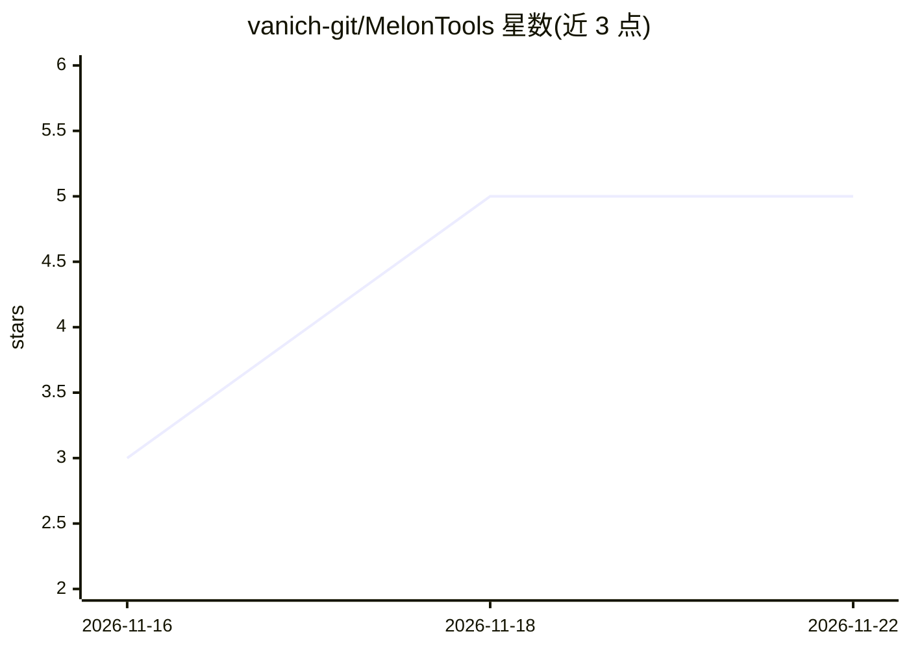

# vanich-git/MelonTools

⭐ 5 · Swift · MIT · 推送 2026-11-18 · [GitHub](https://github.com/vanich-git/MelonTools) · 个人维护 · 中文 README

**本地桌面应用：管理 Codex 账户池、多模型网关与定时任务**

面向日常使用 Codex 的开发者：将 Codex 账户存入本地保险库，展示实时配额，并在 127.0.0.1:18317 运行一个 OpenAI 兼容的本地网关供 Codex 等工具使用；同时接入 Claude、Google Antigravity、OpenRouter 等第三方提供商，在 Codex 选择器中标注每个模型，自动处理容量类错误的重试，并支持按 cron 或间隔运行提示词任务。提供 SwiftUI（macOS）与 Tauri（Windows）两个原生应用，凭据与数据全部留在本机，网关仅监听回环地址。

## 筛选速览

| 维度 | 判定 | 备注 |
|---|---|---|
| AI 角色 | `ai-ecosystem` | LLM/agent 周边工具 |
| 许可风险 | `permissive` | MIT |
| 部署形态 | `desktop` | 安装包/桌面程序 |
| 模型依赖 | local-ok | 支持本地模型 |
| 硬件要求 | — | 无带数字的原话,不猜 |
| 安装摩擦 | `medium` | 含编译或系统依赖之一 |
| 成熟度 | — | 结构信号不足 |

## 能力要点

- Codex 账户池与配额感知的自动暂停守卫
- 本地 OpenAI 兼容网关（127.0.0.1:18317，带 API key、用量指标与审计日志）
- 接入 Claude、Google Antigravity（OAuth）及 OpenRouter 等多家提供商
- 基于 llama-server 的本地 GGUF 模型（127.0.0.1:18318）

## 适用场景

- 管理多个 Codex 账户并在请求间路由分摊配额
- 通过本地网关让多个工具共用已配置的账户
- 按计划定时跑摘要、PR 审查、日志检查等提示词任务

## 场景标签

`模型网关` `代码审查` · 领域:Agent 开发

## 证据(README 行号)

> L25: Melon Tools is a desktop companion for people who work with Codex every day. It keeps your Codex accounts in a loca
> L37: |**Local OpenAI-compatible gateway**|A loopback gateway on `127.0.0.1:18317` with an API key you control, usage met
> L38: |**Model providers**|Claude and Google Antigravity use OAuth; OpenRouter, OpenCode, DeepInfra, Vercel AI Gateway an

## 星数曲线

2026-11-16 3 → 2026-11-22 5（+2）

---
*卡片 v1 · prompt 1.4 · 生成 2026-11-21 · 置信度 high · 依据 README sha `fa634d4875a5` · [字段定义](../../DATASET.md)*
