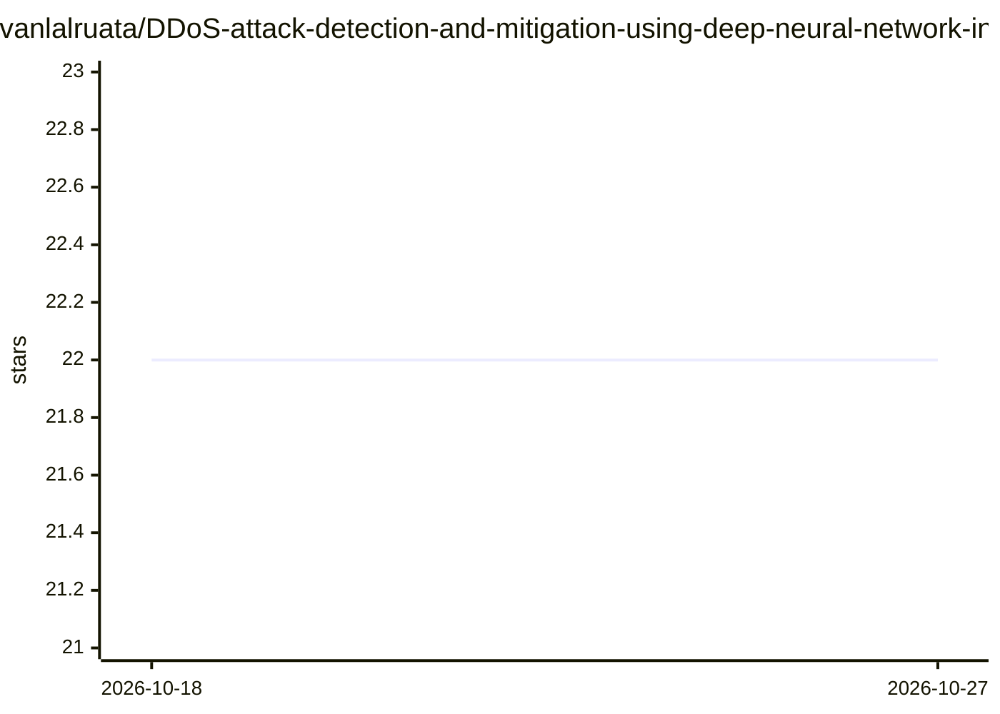

# vanlalruata/DDoS-attack-detection-and-mitigation-using-deep-neural-network-in-SDN-environment

⭐ — · [GitHub]() · 个人维护

**SDN 环境下基于 DNN 的 DDoS 攻击检测与缓解研究代码**

发表于 Computers & Security（Elsevier, 2023）的研究论文配套代码：构建深度神经网络（DNN）模型分析 SDN 环境中的网络流量，识别 DDoS 攻击模式并执行缓解。README 以论文摘要、投稿与录用时间线、DOI、引用方式为主，报告在 InSDN、CICIDS2018 与 Kaggle DDoS 数据集上的检测准确率为 99.98%、100% 与 99.99%。README 未给出安装命令或运行说明，面向网络安全研究者复现论文结果。

## 筛选速览

| 维度 | 判定 | 备注 |
|---|---|---|
| AI 角色 | `ai-native` | 本体是模型或模型工具 |
| 许可风险 | `none` | — |
| 部署形态 | `None` |  |
| 模型依赖 | — | README 未给出锁定关系 |
| 硬件要求 | — | 无带数字的原话,不猜 |
| 安装摩擦 | `low` | 无编译、无系统依赖或容器化 |
| 成熟度 | — | 结构信号不足 |

## 能力要点

- DNN 模型分析 SDN 网络流量检测 DDoS 攻击
- 在 InSDN / CICIDS2018 / Kaggle DDoS 三个数据集上评估
- 配套论文发表于 Computers & Security（DOI: 10.1016/j.cose.2023.103661）

## 适用场景

- 复现论文中 SDN 场景的 DDoS 检测实验
- 在 InSDN / CICIDS2018 数据集上验证 DNN 检测效果
- 网络安全研究中的入侵检测方法参考

## 场景标签

`网络安全` · 领域:学习与行业

## 证据(README 行号)

> L4: In the contemporary digital landscape, the escalating threat landscape of cyber attacks, particularly distributed de
> L26: https://doi.org/10.1016/j.cose.2023.103661

## 星数曲线

2026-10-18 22 → 2026-10-27 22（+0）

---
*卡片 v1 · prompt 1.4 · 生成 2026-10-27 · 置信度 high · 依据 README sha `d079fd48849a` · [字段定义](../../DATASET.md)*
