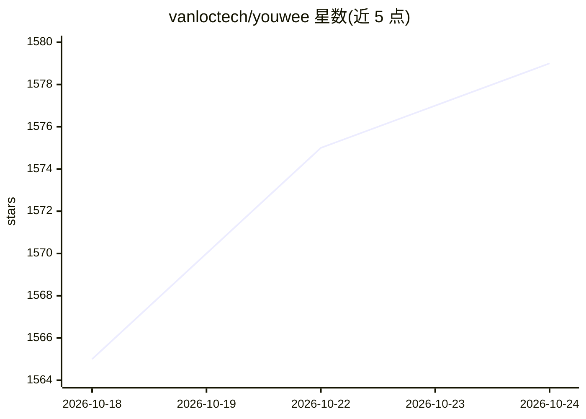

# vanloctech/youwee

⭐ 1,584 · TypeScript · MIT · 推送 2026-09-20 · [GitHub](https://github.com/vanloctech/youwee) · 组织维护 · 中文 README

**跨平台视频下载器（yt-dlp GUI），含 AI 摘要与自然语言剪辑**

基于 Tauri 的桌面应用，封装 yt-dlp 下载 YouTube、TikTok、Instagram、Bilibili 等 1800+ 站点的视频，支持浏览器扩展桥接、Telegram 远程控制、频道关注自动下载、播放列表批量、字幕工作坊与 SponsorBlock 等后处理。AI 功能包括调用 Gemini/OpenAI/Ollama 生成视频摘要、自然语言剪辑视频（切割/转码/缩放/提取音频）以及字幕 AI 翻译与语法修正。提供 Windows/macOS/Linux 安装包与插件体系。

## 筛选速览

| 维度 | 判定 | 备注 |
|---|---|---|
| AI 角色 | `ai-enhanced` | 去掉 AI 部分产品仍成立 |
| 许可风险 | `permissive` | MIT |
| 部署形态 | `desktop` | 安装包/桌面程序 |
| 模型依赖 | local-ok | 支持本地模型 |
| 硬件要求 | — | 无带数字的原话,不猜 |
| 安装摩擦 | `low` | 无编译、无系统依赖或容器化 |
| 成熟度 | — | 结构信号不足 |

## 能力要点

- 下载 1800+ 站点视频，支持直播、批量、播放列表与时间段截取
- AI 视频摘要（Gemini/OpenAI/Ollama）与自然语言视频处理
- 字幕工作坊：AI 翻译、语法修正、Whisper 生成字幕
- 浏览器扩展一键发送下载、Telegram 远程控制、签名插件扩展

## 适用场景

- 一站式下载与管理多平台视频和播放列表
- 用自然语言指令剪辑、转码、提取音频
- 观看前生成视频摘要，或为视频制作和修正字幕
- 关注频道自动追更下载，远程通过 Telegram 添加任务

## 场景标签

`图像视频处理` · 领域:感知与多模态

## 证据(README 行号)

> L19:  **Beautiful and Ultimate yt-dlp GUI & Video Downloader - Processing - Free & Open Source**
> L36: - **AI Video Summary** — Summarize videos with Gemini, OpenAI, or Ollama
> L37: - **AI Video Processing** — Edit videos using natural language (cut, convert, resize, extract audio)

## 星数曲线

2026-10-18 1,565 → 2026-10-24 1,579（+14）

---
*卡片 v1 · prompt 1.4 · 生成 2026-10-21 · 置信度 high · 依据 README sha `755f15f29d8d` · [字段定义](../../DATASET.md)*
