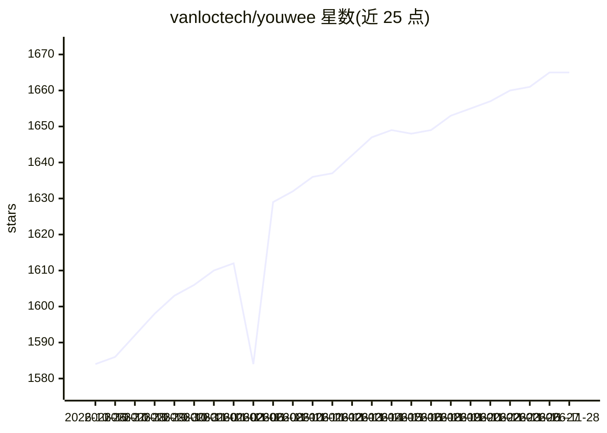

# vanloctech/youwee

⭐ 1,665 · TypeScript · MIT · 推送 2026-11-13 · [GitHub](https://github.com/vanloctech/youwee) · 组织维护 · 中文 README

**面向消费者的 yt-dlp 图形界面视频下载与后处理工具**

基于 Tauri（Rust + React + Bun）构建的跨平台视频下载器，封装 yt-dlp 能力，支持 YouTube、TikTok、Instagram 等 1800+ 站点。核心功能包括播放列表批量下载、音频提取、字幕下载与内嵌、直播流录制、频道关注自动下载、SponsorBlock 跳过、时间段裁剪。AI 部分作为可选功能：调用 Gemini/OpenAI/Ollama 生成视频摘要、自然语言视频剪辑、字幕翻译与语法修正、Whisper 字幕生成。另提供浏览器扩展与 Telegram 远程控制。MIT 许可，未签名 macOS 包需 xattr 放行。

## 筛选速览

| 维度 | 判定 | 备注 |
|---|---|---|
| AI 角色 | `ai-enhanced` | 去掉 AI 部分产品仍成立 |
| 许可风险 | `permissive` | MIT |
| 部署形态 | `desktop` | 安装包/桌面程序 |
| 模型依赖 | local-ok | 支持本地模型 |
| 硬件要求 | — | 无带数字的原话,不猜 |
| 安装摩擦 | `low` | 无编译、无系统依赖或容器化 |
| 成熟度 | — | 结构信号不足 |

## 能力要点

- yt-dlp 图形界面，支持 1800+ 站点、播放列表与直播流下载
- AI 视频摘要支持 Gemini、OpenAI、Ollama 三种后端
- 自然语言视频处理：剪切、转码、调整尺寸、提取音频
- 浏览器扩展一键发送下载任务，Telegram 远程控制下载

## 适用场景

- 批量下载和整理 YouTube/Bilibili 等平台的视频与播放列表
- 下载视频后用 AI 生成内容摘要
- 为视频制作、翻译和修正字幕
- 远程向家中设备推送下载任务

## 场景标签

`语音识别` · 领域:感知与多模态

## 证据(README 行号)

> L19:  **Beautiful and Ultimate yt-dlp GUI & Video Downloader - Processing - Free & Open Source**
> L36: - **AI Video Summary** — Summarize videos with Gemini, OpenAI, or Ollama
> L37: - **AI Video Processing** — Edit videos using natural language (cut, convert, resize, extract audio)

## 星数曲线

2026-10-26 1,584 → 2026-11-28 1,665（+81）

---
*卡片 v1 · prompt 1.4 · 生成 2026-11-23 · 置信度 high · 依据 README sha `cb27907ae15b` · [字段定义](../../DATASET.md)*
