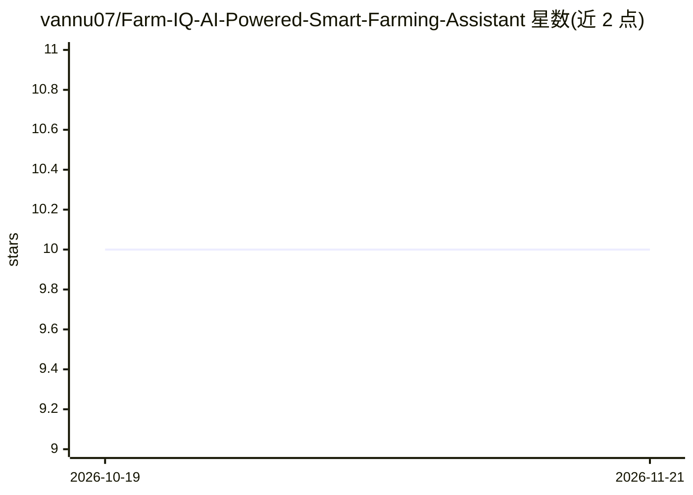

# vannu07/Farm-IQ-AI-Powered-Smart-Farming-Assistant

⭐ 10 · Jupyter Notebook · GPL-3.0 · 推送 2026-01-24 · [GitHub](https://github.com/vannu07/Farm-IQ-AI-Powered-Smart-Farming-Assistant) · 个人维护

**为农民提供作物推荐、施肥建议与病害识别的 Web 助手**

基于 Flask 的农业决策支持 Web 应用，提供三个 ML/DL 功能模块：按土壤 N-P-K 与位置数据推荐作物、按土壤成分与目标作物给出施肥建议、用 ResNet CNN 对 14 种作物的叶片图像做病害识别并给出置信度与处理建议，另含预测历史、可视化仪表盘与 CSV/PDF 报告导出。README 声明为 POC 项目，仅供教育演示，GPL-3.0 许可，要求署名引用。

## 筛选速览

| 维度 | 判定 | 备注 |
|---|---|---|
| AI 角色 | `ai-native` | 本体是模型或模型工具 |
| 许可风险 | `viral` | GPL-3.0 |
| 部署形态 | `library` | 以包/库形式分发 |
| 模型依赖 | — | README 未给出锁定关系 |
| 硬件要求 | — | 无带数字的原话,不猜 |
| 安装摩擦 | `low` | 无编译、无系统依赖或容器化 |
| 成熟度 | `idea` | |

## 能力要点

- 作物推荐（自报准确率 99.2%）与施肥建议模块
- ResNet 病害识别覆盖 14 种作物，输出置信度与治疗建议
- 预测历史追踪与 CSV/PDF 报告导出仪表盘

## 适用场景

- 输入土壤养分数据获取适合种植的作物建议
- 上传叶片照片识别作物病害并查看处理方案
- 记录并导出历次预测做农田趋势分析

## 场景标签

`目标检测` · 领域:感知与多模态

## 证据(README 行号)

> L16: Farm-IQ is an intelligent farming assistant that leverages Machine Learning and Deep Learning to provide farmers wi
> L34: ### 🔍 Disease Detection
> L133: 3. **CNN Analysis:** ResNet-based disease classification

## 星数曲线

2026-10-19 10 → 2026-11-21 10（+0）

---
*卡片 v1 · prompt 1.4 · 生成 2026-11-19 · 置信度 high · 依据 README sha `5fcf25c087c1` · [字段定义](../../DATASET.md)*
