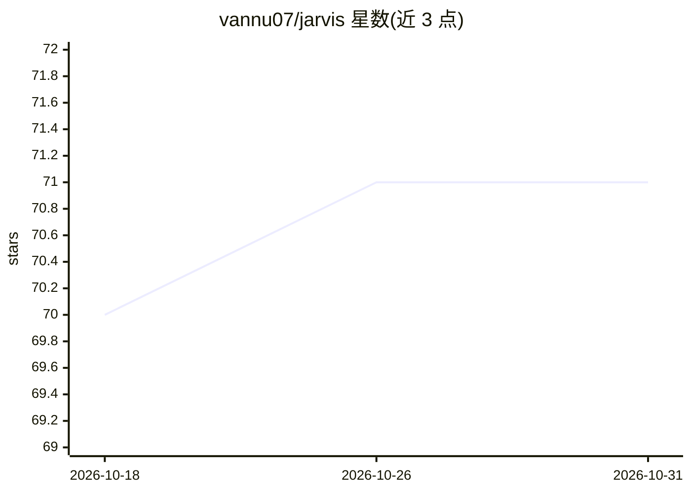

# vannu07/jarvis

⭐ 71 · Python · MIT · 推送 2026-01-14 · [GitHub](https://github.com/vannu07/jarvis) · 个人维护

**带人脸识别认证的语音 AI 助手，语音控制电脑与通讯**

Python 实现的个人语音助手：通过 Google STT 做实时语音识别、Porcupine 做唤醒词检测（Jarvis/Alexa）、Hugging Face 做自然语言处理、OpenCV 做人脸识别登录认证。功能包括语音控制系统应用与窗口、WhatsApp 消息/通话自动化、YouTube 控制、语音查天气（OpenWeatherMap API）与联系人管理。前端为 HTML/JS 网页界面，通过 Eel 与后端桥接，经 python run.py 在 localhost:8000 启动。运行需要麦克风、摄像头与网络连接，需配置 Hugging Face token 与 Porcupine key。

## 筛选速览

| 维度 | 判定 | 备注 |
|---|---|---|
| AI 角色 | `ai-native` | 本体是模型或模型工具 |
| 许可风险 | `permissive` | MIT |
| 部署形态 | `self-host` | docker 或自建部署 |
| 模型依赖 | — | README 未给出锁定关系 |
| 硬件要求 | — | 无带数字的原话,不猜 |
| 安装摩擦 | `low` | 无编译、无系统依赖或容器化 |
| 成熟度 | — | 结构信号不足 |

## 能力要点

- 唤醒词检测（Jarvis/Alexa）+ 人脸识别生物认证登录
- 语音控制：系统操作、WhatsApp 自动化、媒体播放、天气查询
- 网页前端（Eel 桥接）+ SQLite 存储联系人
- 提供 Docker 部署方式与自定义命令扩展接口

## 适用场景

- 用语音唤醒词控制电脑应用、窗口与快捷操作
- 语音发 WhatsApp 消息、打电话、查天气
- 通过人脸识别做助手登录认证
- 自行扩展语音命令处理器

## 场景标签

`语音 Agent` `人脸识别` · 领域:对话与助手

## 证据(README 行号)

> L20: Jarvis is an intelligent voice assistant that combines speech recognition, natural language processing, and compute
> L31: - Real-time Speech Recognition using Google STT

## 星数曲线

2026-10-18 70 → 2026-10-31 71（+1）

---
*卡片 v1 · prompt 1.4 · 生成 2026-10-24 · 置信度 high · 依据 README sha `6abeaf957d1b` · [字段定义](../../DATASET.md)*
