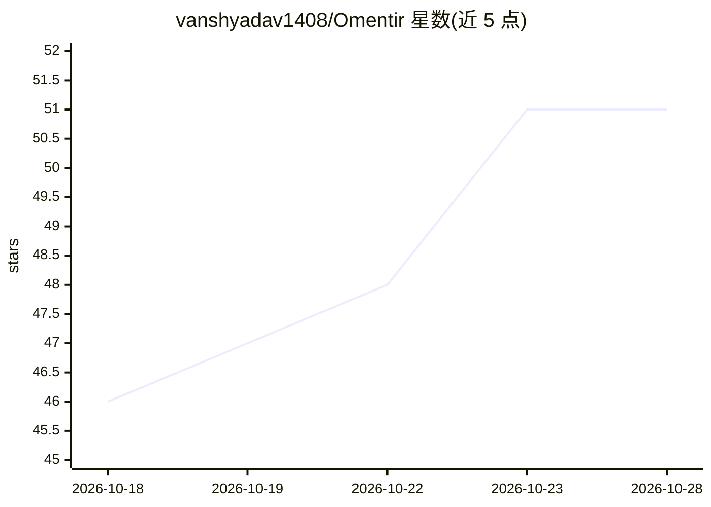

# vanshyadav1408/Omentir

⭐ 51 · TypeScript · MIT · 推送 2026-10-27 · [GitHub](https://github.com/vanshyadav1408/Omentir) · [官网](https://omentir.com) · 个人维护

**开源自托管的 LinkedIn 外联销售工作台（HeyReach 替代）**

Next.js 构建的 LinkedIn 潜在客户寻找、上下文外联草稿（Gemini/Vertex）、拟人节奏外联活动与回复处理工作台，托管版与自托管共用同一代码库（RUN_LOCALLY=TRUE 切换）。自托管需自带 Firebase/Firestore、Unipile 与 Gemini API key 或 Vertex AI 项目，非离线运行。支持 Docker Compose（amd64/arm64）或 Bun 部署，提供 MCP 端点供 Claude/ChatGPT/Grok/Cursor 等 agent 接入，含本地密码登录、会话签名、Webhook 密钥等安全机制，自动化默认 dry-run。

## 筛选速览

| 维度 | 判定 | 备注 |
|---|---|---|
| AI 角色 | `ai-enhanced` | 去掉 AI 部分产品仍成立 |
| 许可风险 | `permissive` | MIT |
| 部署形态 | `self-host` | docker 或自建部署 |
| 模型依赖 | — | README 未给出锁定关系 |
| 硬件要求 | — | 无带数字的原话,不猜 |
| 安装摩擦 | `low` | 无编译、无系统依赖或容器化 |
| 成熟度 | — | 结构信号不足 |

## 能力要点

- 托管云与自托管共用一套代码，RUN_LOCALLY=TRUE 关闭托管专用功能
- MCP 端点与 REST Agent API 供 Claude/ChatGPT/Grok/Cursor 等 agent 调用
- Docker Compose 为受支持的自托管路径（amd64/arm64），默认仅绑定 127.0.0.1
- 依赖外部托管服务：Firebase/Firestore、Unipile（付费）、Gemini API 或 Vertex AI

## 适用场景

- 在我自己的基础设施上跑 LinkedIn 潜客寻找与外联活动，不交出代码与数据
- 从 Claude/ChatGPT/Cursor 等聊天 agent 中直接创建 lead finder 或 Steal Customers agent
- 替代 HeyReach/Gojiberry 等付费外联工具自托管使用

## 场景标签

`工作流自动化` `AI 写作` · 领域:效率与自动化

## 证据(README 行号)

> L7: It's an AI sales workspace for finding qualified LinkedIn prospects, drafting contextual outreach, running human-pac
> L9: Use the managed product at omentir.com, or self-host the same application code with your own Firebase, Gemini, and U

## 星数曲线

2026-10-18 46 → 2026-10-28 51（+5）

---
*卡片 v1 · prompt 1.4 · 生成 2026-10-24 · 置信度 high · 依据 README sha `3167bbf2bcb1` · [字段定义](../../DATASET.md)*
