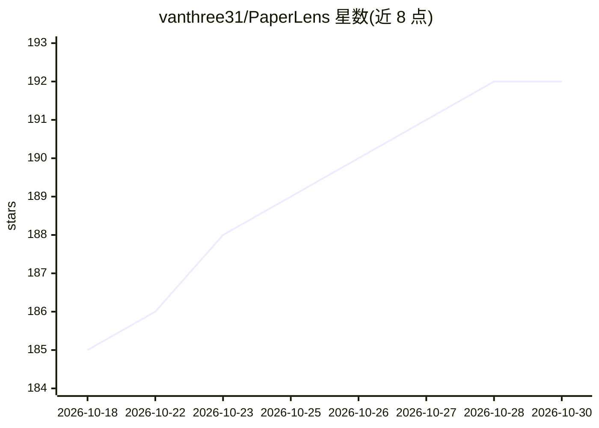

# vanthree31/PaperLens

⭐ 192 · Python · NOASSERTION · 推送 2026-10-19 · [GitHub](https://github.com/vanthree31/PaperLens) · 个人维护 · 中文 README

**面向科研人员的本地优先 AI 文献检索与分析助手**

自托管的学术研究工作流应用：以自然语言输入研究问题，AI 构建检索式并行搜索 43/46 个学术数据库（PubMed、arXiv、Scopus、CNKI 等），去重排序后提供七维结构化论文精读分析、多论文对比、新颖性检测，并以 D3.js 呈现引文网络、作者合作网络。支持 CARSI 认证访问 300+ 中国高校订阅资源，可导出 RIS/BibTeX 等格式并与 Zotero 双向同步。AI 处理可完全离线（Ollama），也可切换 DeepSeek/OpenAI/Anthropic 云 API。Python/Flask 后端，Windows 提供独立 exe，macOS/Linux 从源码运行；采用社区许可（个人/学术/科研用途免费）。

## 筛选速览

| 维度 | 判定 | 备注 |
|---|---|---|
| AI 角色 | `ai-native` | 本体是模型或模型工具 |
| 许可风险 | `none` | NOASSERTION |
| 部署形态 | `desktop` | 安装包/桌面程序 |
| 模型依赖 | local-ok | 支持本地模型 |
| 硬件要求 | — | 无带数字的原话,不猜 |
| 安装摩擦 | `low` | 无编译、无系统依赖或容器化 |
| 成熟度 | — | 结构信号不足 |

## 能力要点

- 自然语言检索 43 个学术数据库并行搜索并去重排序
- 七维结构化 AI 深度分析、多论文对比与新颖性检测
- D3.js 交互式引文图、关键词共现与作者合作网络
- CARSI 认证免 VPN 访问 300+ 中国高校订阅资源
- Ollama 完全离线运行，另支持 DeepSeek/OpenAI/Anthropic

## 适用场景

- 用一句话描述研究问题，跨多个学术库一次性检索文献
- 让 AI 精读论文并生成方法/创新/局限等七维分析
- 做多论文对比找研究空白与矛盾结论
- 通过 CARSI 在校外免 VPN 访问 ScienceDirect/Scopus/JSTOR

## 场景标签

`科研工具` · 领域:学习与行业

## 证据(README 行号)

> L23: PaperLens is an **AI research copilot** that turns the messy, fragmented process of academic literature work into a
> L53: Describe your research question in natural language. PaperLens searches **43 databases at once**, ranks results by 
> L55: - **Read a paper in 2 minutes instead of 30** — AI extracts what matters: method, innovation, strengths, weaknesses

## 星数曲线

2026-10-18 185 → 2026-10-30 192（+7）

---
*卡片 v1 · prompt 1.4 · 生成 2026-10-22 · 置信度 mid · 依据 README sha `0488f4a7f492` · [字段定义](../../DATASET.md)*
