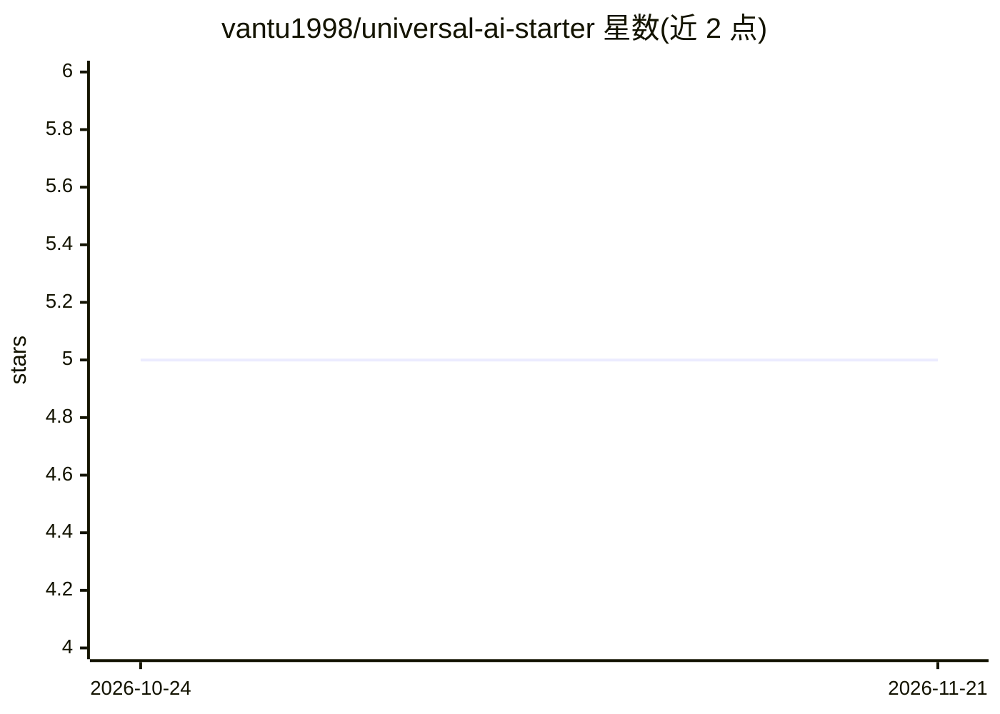

# vantu1998/universal-ai-starter

⭐ 5 · PowerShell · MIT · 推送 2026-10-23 · [GitHub](https://github.com/vantu1998/universal-ai-starter) · [官网](https://github.com/vantu1998/universal-ai-starter/releases/tag/v1.3.0) · 个人维护

**为 AI 编码工具注入规范驱动工作流的仓库内框架**

一个以文件为状态的仓库内框架，向 Cursor、Claude Code、Antigravity、Copilot 等编码代理注入统一的工作流：用 STATE.md/AGENTS.md/.ai/ 上下文图锚定项目状态与架构约束，提供 /feature、/refactor、/review、/knowledge-review 四个 slash 命令，PreToolUse hook 拦截破坏性命令，并支持跨工具配额耗尽时基于 STATE.md 与 git log 的接力。通过一行安装脚本注入现有项目或 GitHub Template 建新仓库，MIT 许可。

## 筛选速览

| 维度 | 判定 | 备注 |
|---|---|---|
| AI 角色 | `ai-ecosystem` | LLM/agent 周边工具 |
| 许可风险 | `permissive` | MIT |
| 部署形态 | `None` |  |
| 模型依赖 | locked-api |  |
| 硬件要求 | — | 无带数字的原话,不猜 |
| 安装摩擦 | `medium` | 含编译或系统依赖之一 |
| 成熟度 | — | 结构信号不足 |

## 能力要点

- File-as-State：STATE.md 与 .ai/ 上下文图实现上下文锚定与跨工具接力
- PreToolUse guard hook 拦截 rm -rf、git push --force 等破坏性命令
- 4 个标准化 slash 命令（/feature、/refactor、/review、/knowledge-review）
- sync.sh 将 .ai/ 规范文件投影为 Cursor/Claude Code/Antigravity 的原生适配器

## 适用场景

- 在现有项目中为 AI 编码代理建立规范驱动的工作流
- API 配额耗尽时在 Cursor 与 Claude Code 之间无缝交接任务
- 拦截 AI 执行危险终端命令或读取 .env 密钥
- 把生产 bug 经验沉淀为仓库内持久知识

## 场景标签

`提示工程` `编码 Agent` · 领域:Agent 开发

## 证据(README 行号)

> L12:  Universal AI-OS is a lightweight, spec-driven in-repo framework that turns LLMs from chaotic vibe-coders into disc
> L163: |Tool / Agent|Support Level|Integration Mechanism|

## 星数曲线

2026-10-24 5 → 2026-11-21 5（+0）

---
*卡片 v1 · prompt 1.4 · 生成 2026-11-21 · 置信度 high · 依据 README sha `bca83c9221a3` · [字段定义](../../DATASET.md)*
