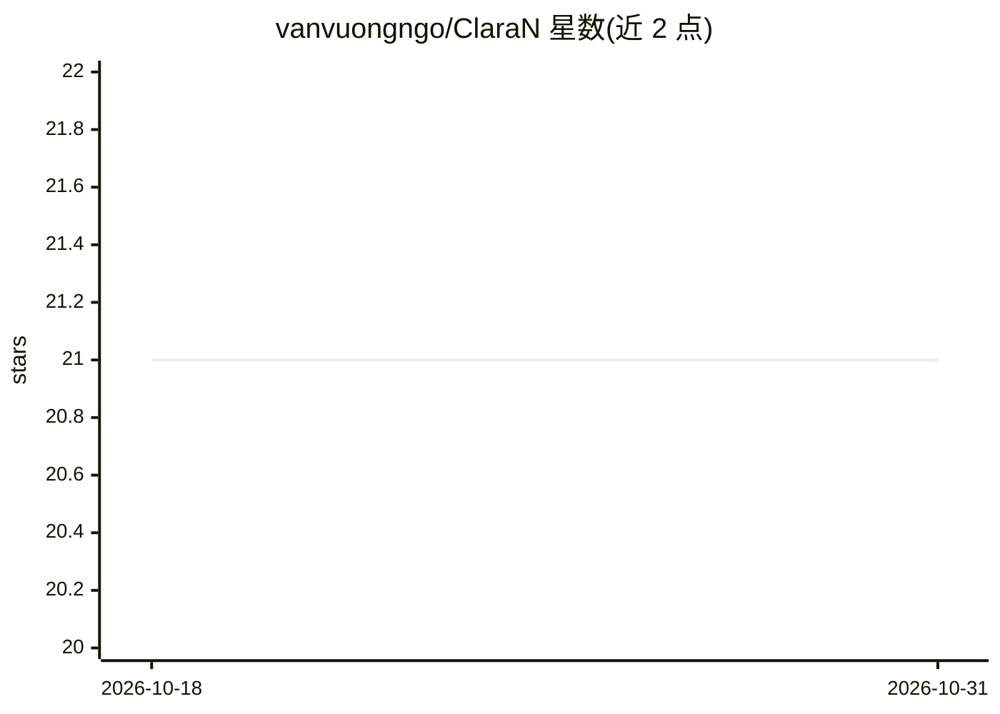

# vanvuongngo/ClaraN

⭐ 21 · Kotlin · MIT · 推送 2025-12-02 · [GitHub](https://github.com/vanvuongngo/ClaraN) · 个人维护

**本地优先的多端 AI 工作区：Ollama 聊天、移动与桌面应用**

ClaraVerse 的 hardfork，基于 Tauri+Qwik+Rust 的本地 AI 聊天应用，面向自托管用户。当前版本提供带多 provider 支持的聊天界面（0.2.0 起 Ollama），已发布 Android、Windows、macOS、Linux 应用（iOS 仅模拟器）；描述中的 agent builder、Stable Diffusion、n8n 自动化等在 README 对比表中标记为 ClaraVerse 而非 ClaraN 的能力，Docker 部署与 0.4.0 仍在开发中。开发安装通过 pnpm，Android 运行需 Termux+Ollama。

## 筛选速览

| 维度 | 判定 | 备注 |
|---|---|---|
| AI 角色 | `ai-native` | 本体是模型或模型工具 |
| 许可风险 | `permissive` | MIT |
| 部署形态 | `desktop` | 安装包/桌面程序 |
| 模型依赖 | local-ok | 支持本地模型 |
| 硬件要求 | — | 无带数字的原话,不猜 |
| 安装摩擦 | `medium` | 含编译或系统依赖之一 |
| 成熟度 | `idea` | |

## 能力要点

- 桌面三平台（dmg/exe/AppImage/deb/rpm）与 Android 构建已发布
- 聊天界面支持多 provider，含 Ollama 本地后端
- 本地加密存储、零遥测、MIT 许可
- 桌面安装包含自动更新

## 适用场景

- 在本机或局域网内运行私有 LLM 聊天
- 不想用 Web UI、偏好桌面/移动原生应用
- 通过 Termux 在 Android 设备上离线跑模型

## 场景标签

`聊天机器人` · 领域:对话与助手

## 证据(README 行号)

> L5: ClaraN isn't just another chat UI. It's a complete AI ecosystem that runs 100% on your machines.
> L194: |🧠 **Clara AI Assistant**|0.4.0 open|Chat Interface with multi-provider support|
> L196: |🧠 **Clara AI Assistant**|✅ **0.2.0 Released**|Chat Interface with ollama provider support|

## 星数曲线

2026-10-18 21 → 2026-10-31 21（+0）

---
*卡片 v1 · prompt 1.4 · 生成 2026-10-28 · 置信度 mid · 依据 README sha `c14b4d7d3421` · [字段定义](../../DATASET.md)*
