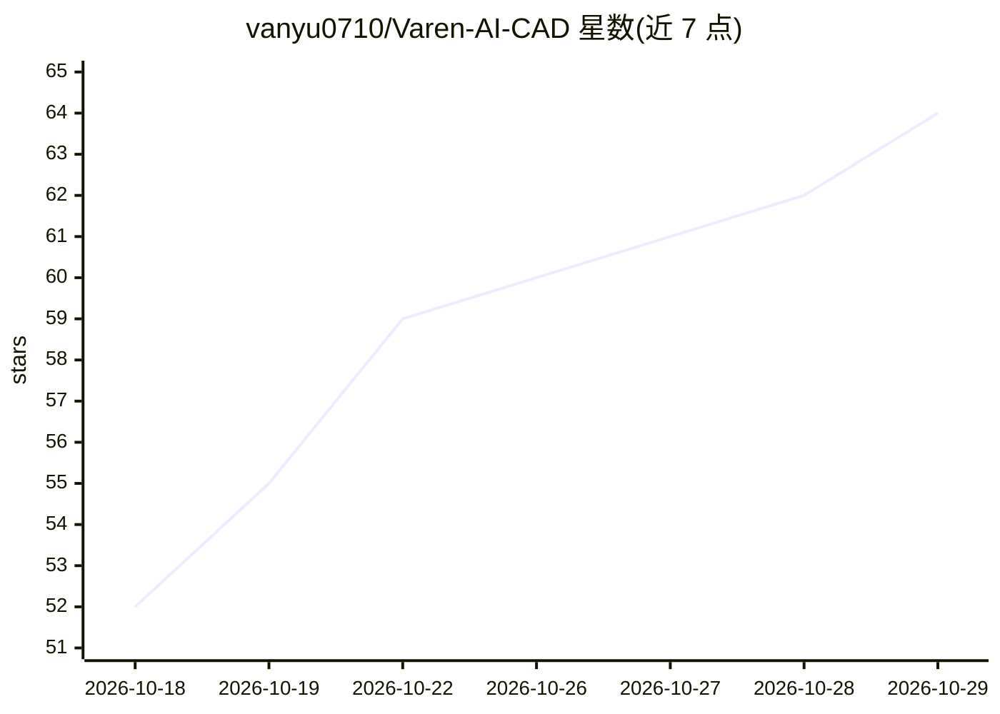

# vanyu0710/Varen-AI-CAD

⭐ 64 · AGPL-3.0 · 推送 2026-10-22 · [GitHub](https://github.com/vanyu0710/Varen-AI-CAD) · [官网](https://vanyu0710.github.io/Varen-AI-CAD/) · 个人维护 · 中文 README

**AI CAD 建模 Agent：一句话需求产出可复核的参数化装配**

面向机械/机器人/硬件团队的 Windows 桌面应用，封闭 Beta。用户给出一句话需求后，Agent 先做工程计算与结构化提问，产出 BOM 计划待用户审批，再逐件通过 OpenCascade 内核完成参数化 BRep 建模，导出 STEP/STL 及 .vpart/.vasm 源文件。关键机制：几何验证与干涉检查作为硬门控，失败即拒绝交付，production_ready 始终为 false；本地优先存储，模型层支持 OpenAI 兼容端点或内置云端端点。仓库已转为发布门户，不含源码；历史开源代码以 AGPL-3.0 分叉存在但不由官方维护。明确不提供完整 2D 工程图、公差标注、通用装配求解器等能力。

## 筛选速览

| 维度 | 判定 | 备注 |
|---|---|---|
| AI 角色 | `ai-native` | 本体是模型或模型工具 |
| 许可风险 | `dual` | AGPL-3.0 |
| 部署形态 | `desktop` | 安装包/桌面程序 |
| 模型依赖 | — | README 未给出锁定关系 |
| 硬件要求 | — | 无带数字的原话,不猜 |
| 安装摩擦 | `low` | 无编译、无系统依赖或容器化 |
| 成熟度 | `idea` | |

## 能力要点

- 调研→提问→BOM→逐件建模→装配导出的 Agent 工作流，BOM 审批为硬门控
- OpenCascade 参数化 BRep 建模，导出 STEP/STL 与 .vpart/.vasm 可编辑交付件
- 几何验证与干涉检查不过关即拒绝交付，失败生成结构化报告并可回滚
- Evidence-first 工程知识库（原件与 SHA256、人工审核发布）与受限子代理

## 适用场景

- 从一句话需求快速产出概念设计与原型用装配 STEP
- 在数据敏感的硬件团队本地保存任务数据并全程审阅 Agent 步骤
- 上传草图作参考，让 Agent 逐件建模并逐项验证几何与干涉
- 导出 STEP 到其他 CAD 软件做人工工程复核

## 场景标签

`AI 助手` · 领域:对话与助手

## 证据(README 行号)

> L5:  AI CAD 建模 Agent： 一句话需求进来，先调研计算、结构化提问、出 BOM 计划待你批准，再逐件完成真实 CAD 建模与装配，导出 STEP——参数化 BRep，不是图片或网格。
> L89: - 模型层支持 OpenAI-compatible 端点，包括用户自行管理的端点。

## 星数曲线

2026-10-18 52 → 2026-10-29 64（+12）

---
*卡片 v1 · prompt 1.4 · 生成 2026-10-24 · 置信度 high · 依据 README sha `9562348986a9` · [字段定义](../../DATASET.md)*
