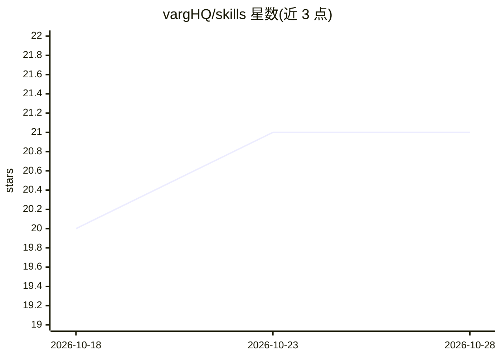

# vargHQ/skills

⭐ 21 · JavaScript · MIT · 推送 2026-10-28 · [GitHub](https://github.com/vargHQ/skills) · [官网](https://varg.ai) · 组织维护

**面向 AI agent 的视频/图像/语音/音乐生成技能集**

基于 varg 平台的 Agent Skills 技能合集，包含 9 个技能：通过单一 varg-ai 技能以提示词访问 Seedance、Kling、Veo、ElevenLabs 等 200+ 生成模型，另有视频预演规划、多镜头音乐视频、角色一致性广告、播客视频等专用技能，以及本地媒体下载与技能检索技能。兼容 Claude Code、Cursor、Windsurf、OpenCode、ClawHub 等支持 Agent Skills 标准的工具。云模式仅需 curl，本地模式需 bun 与 ffmpeg，部分技能需 VARG_API_KEY。

## 筛选速览

| 维度 | 判定 | 备注 |
|---|---|---|
| AI 角色 | `ai-ecosystem` | LLM/agent 周边工具 |
| 许可风险 | `permissive` | MIT |
| 部署形态 | `library` | 以包/库形式分发 |
| 模型依赖 | — | README 未给出锁定关系 |
| 硬件要求 | — | 无带数字的原话,不猜 |
| 安装摩擦 | `medium` | 含编译或系统依赖之一 |
| 成熟度 | — | 结构信号不足 |

## 能力要点

- 单一技能访问 200+ 视频/图像/语音/音乐生成模型
- 兼容 Claude Code、Cursor、Windsurf、OpenCode、ClawHub 等 Agent Skills 标准工具
- 提供预演规划、音乐视频、角色一致性多场景广告等垂直工作流技能
- 云模式仅依赖 curl；GitHub Actions 自动发布技能到 ClawHub

## 适用场景

- 在 Claude Code 或 Cursor 中用自然语言生成视频/图像/语音/音乐
- 规划并制作多镜头 AI 音乐视频或角色一致性广告
- 为 agent 安装跨格式媒体生成能力

## 场景标签

`视频生成` `图像生成` `语音合成` · 领域:内容生成

## 证据(README 行号)

> L3: A collection of Agent Skills for AI video, image, speech, and music generation using the varg platform. One skill to
> L8: Works with **Claude Code**, **Cursor**, **Windsurf**, **OpenCode**, **ClawHub**, and any tool that supports the Agen

## 星数曲线

2026-10-18 20 → 2026-10-28 21（+1）

---
*卡片 v1 · prompt 1.4 · 生成 2026-10-28 · 置信度 high · 依据 README sha `b2d118b147be` · [字段定义](../../DATASET.md)*
