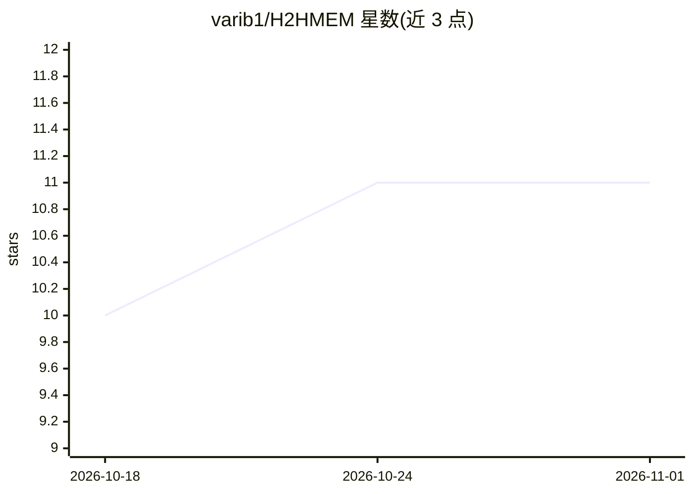

# varib1/H2HMEM

⭐ 11 · Python · 推送 2026-06-21 · [GitHub](https://github.com/varib1/H2HMEM) · [官网](https://h2hmemprojectpage.vercel.app/) · 组织维护

**评测人人对话中多模态 LLM 记忆能力的基准（25 对话/2236 QA）**

面向 LLM agent 作为人人交互观察者场景的多模态记忆基准：由 25 个对话（20 双人 + 5 多方）、309 个会话、7,078 轮对话、1,300 张图像构成，覆盖记忆回忆/推理/应用三类能力下的 9 种任务类型（UPR/CRR/KR/TR/MCR/RET/TTL/CD/AR）。数据集托管于 Hugging Face，仓库提供文本与多模态两类基线（FullText/Naive RAG/A-MEM/FullMM/MuRAG/NGM）的运行脚本，指标含词法指标与 LLM-as-a-Judge，并附在线排行榜与提交模板。文本方法需先经图像生成 caption 阶段。

## 筛选速览

| 维度 | 判定 | 备注 |
|---|---|---|
| AI 角色 | `ai-ecosystem` | LLM/agent 周边工具 |
| 许可风险 | `none` | — |
| 部署形态 | `library` | 以包/库形式分发 |
| 模型依赖 | — | README 未给出锁定关系 |
| 硬件要求 | — | 无带数字的原话,不猜 |
| 安装摩擦 | `low` | 无编译、无系统依赖或容器化 |
| 成熟度 | — | 结构信号不足 |

## 能力要点

- 25 对话/309 会话/1,300 图像/2,236 QA 对的多模态记忆评测集
- 记忆回忆、推理、应用三能力 × 9 种任务类型
- 内置 6 种基线方法（文本与多模态两类）的运行脚本
- 词法指标 + LLM-as-a-Judge 双评测与在线排行榜提交流程

## 适用场景

- 评测我开发的 agent 记忆方法在多方多模态对话中的表现
- 通过排行榜对比不同记忆系统的得分
- 复现 A-MEM/MuRAG 等基线并做改进研究

## 场景标签

`Agent 记忆` `模型评测` `多模态` · 领域:Agent 开发

## 证据(README 行号)

> L3:  H2HMem evaluates multimodal LLM memory in realistic human-to-human interactions ,
> L45: H2HMem evaluates three core memory capabilities across nine task types:

## 星数曲线

2026-10-18 10 → 2026-11-01 11（+1）

---
*卡片 v1 · prompt 1.4 · 生成 2026-11-01 · 置信度 high · 依据 README sha `af2d28a105fb` · [字段定义](../../DATASET.md)*
