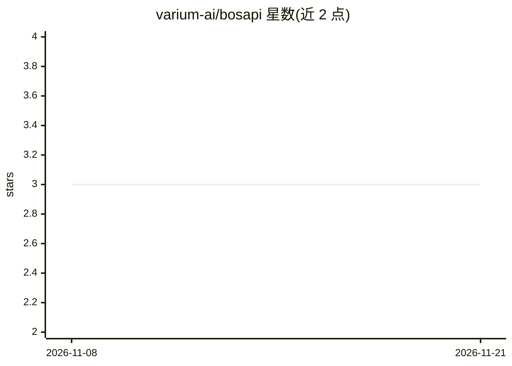

# varium-ai/bosapi

⭐ 3 · Go · MIT · 推送 2026-11-20 · [GitHub](https://github.com/varium-ai/bosapi) · [官网](https://bosapi.net/) · 组织维护

**自托管 AI 网关：团队模型访问控制、内容检查与用量核算**

用 Go + React + TypeScript 构建的自托管 AI 网关和管理控制台，将上游模型连接、组织权限、API Key、内容检查与用量记录集中在同一网关中。支持 OpenAI、Anthropic、Gemini 协议接口，按组织分配模型与通道，API Key 可配置访问策略、配额与速率限制。提供凭据检查、输入脱敏、输出代码标记观察等本地检查能力。社区版限 2 个组织与 10 个 API Key，通过 Docker Compose 从源码构建部署，需自备上游账号、凭据与模型额度。

## 筛选速览

| 维度 | 判定 | 备注 |
|---|---|---|
| AI 角色 | `ai-ecosystem` | LLM/agent 周边工具 |
| 许可风险 | `permissive` | MIT |
| 部署形态 | `self-host` | docker 或自建部署 |
| 模型依赖 | — | README 未给出锁定关系 |
| 硬件要求 | — | 无带数字的原话,不猜 |
| 安装摩擦 | `low` | 无编译、无系统依赖或容器化 |
| 成熟度 | — | 结构信号不足 |

## 能力要点

- 支持 OpenAI Chat Completions/Responses、Anthropic Messages、Gemini 协议接口
- 按组织分配模型与通道，API Key 支持策略、配额与速率限制
- 本地运行的内置检查：凭据检查、当前输入脱敏、输出代码标记与工具授权检查
- 用量与成本记录、请求诊断、运行健康与安全事件统一控制台

## 适用场景

- 团队内部共享接入自备的上游模型服务并按组织隔离
- 对经过网关的请求做凭据脱敏与安全事件审计
- 统计各组织/Key 的 token、缓存与成本用量
- 自托管部署并保留数据在自有环境中

## 场景标签

`模型网关` · 领域:Agent 开发

## 证据(README 行号)

> L5:  A self-hosted AI gateway for your team.
> L19: content checks, and usage records into one gateway and administration console.
> L56: Protocol support includes OpenAI Chat Completions and Responses, Anthropic

## 星数曲线

2026-11-08 3 → 2026-11-21 3（+0）

---
*卡片 v1 · prompt 1.4 · 生成 2026-11-21 · 置信度 mid · 依据 README sha `331d6629bfb0` · [字段定义](../../DATASET.md)*
