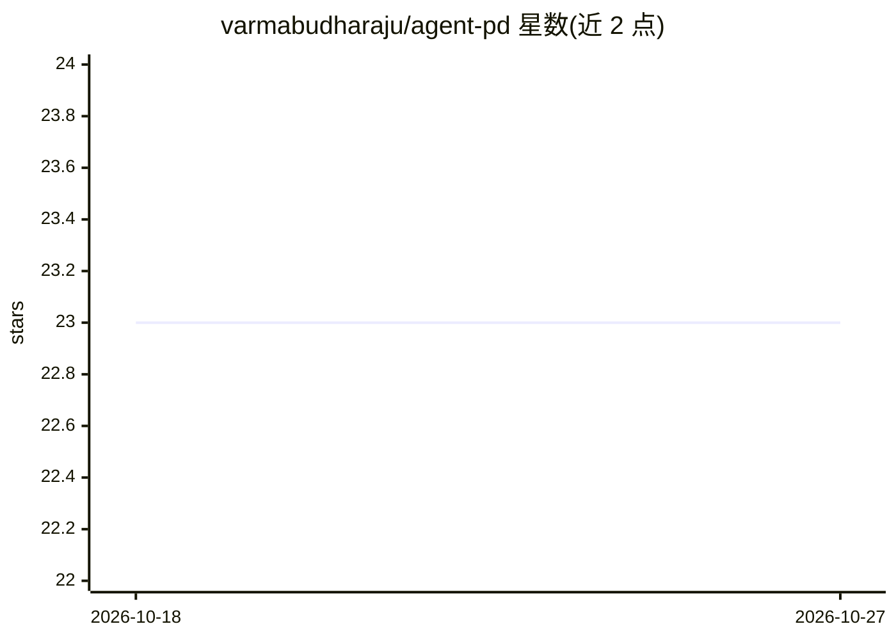

# varmabudharaju/agent-pd

⭐ 23 · Python · Apache-2.0 · 推送 2026-06-11 · [GitHub](https://github.com/varmabudharaju/agent-pd) · 个人维护

**Claude Code agent 行为审计工具：hook 记录+CLI 检测违规并出报告**

面向使用 Claude Code 的开发者的只记录不拦截审计工具：全局 hook 在 ~/.claude/settings.json 注册，把主 agent 与所有 subagent 的工具/权限事件逐条追加到按会话哈希链保护的 JSONL 审计日志（被拒调用也记录）；pd CLI 读取日志跑六个确定性检测器（权限绕过、越界与凭据访问、自我授权、未允许工具、冗余、离题），以引用证据输出报告，并提供 pd list/watch 实时视图。可选 pd judge 用 LLM（Claude CLI 或 Anthropic API）复核离题标记。核心零 token、纯 Python，PyPI 安装。

## 筛选速览

| 维度 | 判定 | 备注 |
|---|---|---|
| AI 角色 | `ai-ecosystem` | LLM/agent 周边工具 |
| 许可风险 | `permissive` | Apache-2.0 |
| 部署形态 | `library` | 以包/库形式分发 |
| 模型依赖 | — | README 未给出锁定关系 |
| 硬件要求 | — | 无带数字的原话,不猜 |
| 安装摩擦 | `low` | 无编译、无系统依赖或容器化 |
| 成熟度 | — | 结构信号不足 |

## 能力要点

- 覆盖主 agent 与全部 subagent（含 Workflow 动态子代理）的逐事件记录
- 六个确定性检测器 + 哈希链防篡改审计日志与可选异地 append-only sink
- 会话以项目目录+首条用户提示命名，追溯生效于已有会话
- 可选 off_task LLM 复核：默认 dry-run、批量、费用上限

## 适用场景

- 让 Claude Code 多 agent 会话留下可追溯、防篡改的行为日志
- 事后或实时查看 agent 是否越界读凭据、提权或改自身配置
- 用 pd report 对代理会话做出具引用证据的违规报告

## 场景标签

 · 领域:AI agent 安全/可观测性

## 证据(README 行号)

> L5: A logging-only hook records every tool &amp; permission event from the main agent **and** its
> L6: subagents; the `pd` CLI replays that log through six detectors and reports rule offenses with
> L79: - **All the intelligence is in the reader.** `pd report` / `pd watch` correlate the audit log
> L81:  detectors. Zero LLM tokens — pure Python.

## 星数曲线

2026-10-18 23 → 2026-10-27 23（+0）

---
*卡片 v1 · prompt 1.4 · 生成 2026-10-27 · 置信度 mid · 依据 README sha `7fcd9d74152f` · [字段定义](../../DATASET.md)*
