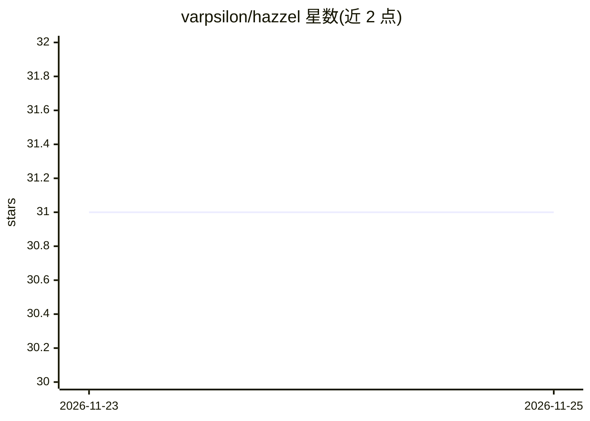

# varpsilon/hazzel

⭐ 31 · Python · Apache-2.0 · 推送 2026-11-23 · [GitHub](https://github.com/varpsilon/hazzel) · [官网](https://agenthazzel.vercel.app) · 个人维护

**终端里的代码编辑 agent，BYOK 无订阅，写盘前 diff 确认**

以 Python 编写的终端编码 agent：读取、搜索、编辑仓库文件并运行 shell 命令，所有写操作先展示 diff 等待用户确认，并自动快照到本地 undo 目录支持选择性回滚；命令沙盒限定在项目根内并拦截部分 git 破坏性操作。提供 /review、/commit、/usage 等斜杠命令、MCP stdio 客户端与 SKILL.md 技能加载、会话持久化与 CI 可用的单轮 JSON 输出模式。支持 8 个 provider 环境变量接入，无订阅、BYOK。

## 筛选速览

| 维度 | 判定 | 备注 |
|---|---|---|
| AI 角色 | `ai-native` | 本体是模型或模型工具 |
| 许可风险 | `permissive` | Apache-2.0 |
| 部署形态 | `library` | 以包/库形式分发 |
| 模型依赖 | local-ok | 支持本地模型 |
| 硬件要求 | — | 无带数字的原话,不猜 |
| 安装摩擦 | `low` | 无编译、无系统依赖或容器化 |
| 成熟度 | `idea` | |

## 能力要点

- 每次写盘前 diff 确认，/undo 选择性快照回滚（保留用户后续编辑）
- 8 个 provider 各一个环境变量接入，Ollama 本地免 key
- MCP stdio 客户端零新增依赖，SKILL.md 技能按需加载
- hazzel -p 单轮模式输出 JSON 与真实退出码，可入 CI 管道

## 适用场景

- 在终端里让 agent 定位并修复失败的测试
- 对话式生成 /review、/commit 等带 diff 预览的 git 操作
- 接入本地 Ollama 模型做零成本代码编辑
- 在 CI 中以 JSON 输出模式管道化调用

## 场景标签

`编码 Agent` · 领域:编码与开发

## 证据(README 行号)

> L5:  A terminal coding agent you can actually read.
> L23: Every agent claims transparency. Hazzel is ~10k lines of Python you can trace end to end — `agent/core.py` is the w
> L107: ## Providers — bring your own key, no subscription

## 星数曲线

2026-11-23 31 → 2026-11-25 31（+0）

---
*卡片 v1 · prompt 1.4 · 生成 2026-11-23 · 置信度 high · 依据 README sha `708cc2c19f6d` · [字段定义](../../DATASET.md)*
