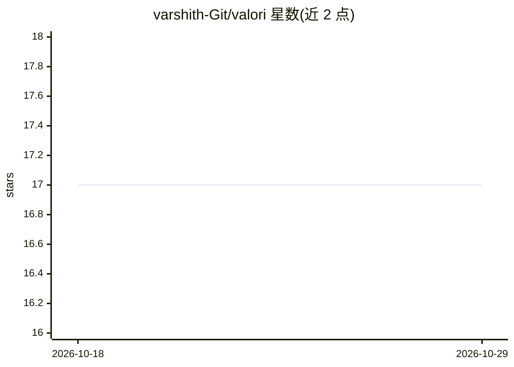

# varshith-Git/valori

⭐ 17 · Python · MIT · 推送 2026-05-03 · [GitHub](https://github.com/varshith-Git/valori) · [官网](https://valori-python-vector-db.lovable.app/) · 个人维护

**给 Python 开发者的高维向量存储、索引与检索库**

纯 Python 实现并集成 NumPy 的向量数据库库：提供内存/磁盘/混合三种存储后端，Flat、HNSW、IVF、LSH、Annoy 五种索引，以及标量/乘积/SAQ 三种向量量化方法降低内存占用；另含 PDF/Office/文本文档解析（可选 Docling 高级解析）与清洗、分块、嵌入的处理管线，并支持插件架构扩展自定义组件。README 声明项目处于早期开发阶段，可能出现 bug 与破坏性变更。

## 筛选速览

| 维度 | 判定 | 备注 |
|---|---|---|
| AI 角色 | `ai-ecosystem` | LLM/agent 周边工具 |
| 许可风险 | `permissive` | MIT |
| 部署形态 | `library` | 以包/库形式分发 |
| 模型依赖 | — | README 未给出锁定关系 |
| 硬件要求 | — | 无带数字的原话,不猜 |
| 安装摩擦 | `low` | 无编译、无系统依赖或容器化 |
| 成熟度 | `idea` | |

## 能力要点

- 三种存储后端：内存/磁盘/混合
- Flat/HNSW/IVF/LSH/Annoy 五种索引可选
- 标量/乘积/SAQ 向量量化降低内存占用
- 文档解析与处理管线（清洗、分块、嵌入）

## 适用场景

- 在 Python 应用中存储与相似度检索高维向量
- 处理文档并入库构建语义搜索
- 通过选择索引与量化策略控制内存与检索延迟

## 场景标签

 · 领域:向量数据库/检索基础设施

## 证据(README 行号)

> L15: A high-performance vector database library for Python that provides efficient storage, indexing, and search capabil
> L25: - **🔄 Processing Pipeline**: Complete document processing with cleaning, chunking, and embedding

## 星数曲线

2026-10-18 17 → 2026-10-29 17（+0）

---
*卡片 v1 · prompt 1.4 · 生成 2026-10-29 · 置信度 high · 依据 README sha `4fc5dfc29c46` · [字段定义](../../DATASET.md)*
