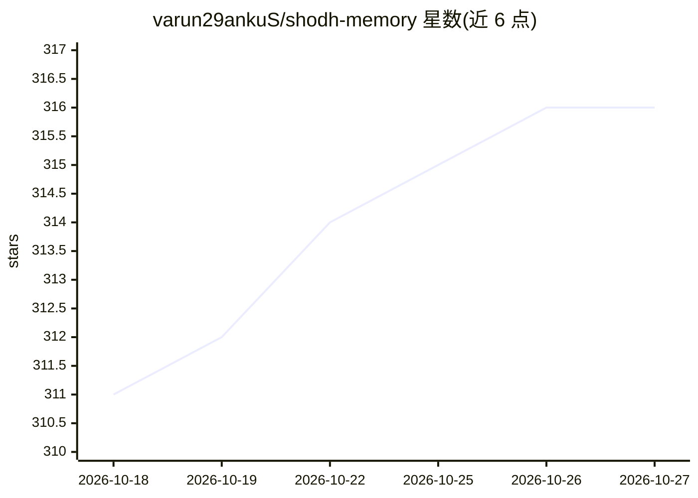

# varun29ankuS/shodh-memory

⭐ 316 · Rust · Apache-2.0 · 推送 2026-10-26 · [GitHub](https://github.com/varun29ankuS/shodh-memory) · [官网](https://www.shodh-memory.com) · 个人维护

**AI 代理与机器人的本地持久记忆：单个 Rust 二进制、无 LLM 调用**

面向 AI 代理和机器人的持久记忆系统，以单个离线 Rust 二进制（约 17MB）提供，存储与回忆均不调用 LLM：本地 ONNX 嵌入、交叉编码器重排、GLiNER 实体抽取与规则式关系抽取构建类型化知识图谱，并用 Hebbian 强化、衰减与扩散激活等机制实现随使用学习的记忆动态。支持 MCP/HTTP 接入 Claude Code、Cursor 等 MCP 客户端，支持 Zenoh/ROS2 机器人接入，提供 51 个 MCP 工具与 160+ REST 端点；可通过 CLI、pip、cargo、npm MCP 包或 Docker 部署，覆盖 Linux/macOS/Windows 五个平台。

## 筛选速览

| 维度 | 判定 | 备注 |
|---|---|---|
| AI 角色 | `ai-ecosystem` | LLM/agent 周边工具 |
| 许可风险 | `permissive` | Apache-2.0 |
| 部署形态 | `self-host` | docker 或自建部署 |
| 模型依赖 | — | README 未给出锁定关系 |
| 硬件要求 | `cpu-ok` | |
| 安装摩擦 | `low` | 无编译、无系统依赖或容器化 |
| 成熟度 | — | 结构信号不足 |

## 能力要点

- 存储与回忆全程零 LLM 调用，纯本地算法（嵌入/重排/NER/关系抽取）
- Hebbian 强化、激活衰减、扩散激活等记忆动态与三级记忆分层（RocksDB 长期层）
- 51 个 MCP 工具、160+ REST 端点、Zenoh/ROS2 原生机器人接入
- 单二进制、无云无外部数据库无 API key，含 Docker 与 systemd 部署路径

## 适用场景

- 为 Claude Code、Cursor 等 MCP 客户端加跨会话持久记忆
- 让 ROS2/PX4/Spot 等机器人在任务与断电间保留记忆
- 在离线或边缘环境为代理提供毫秒级记忆读写
- 通过 REST API 为自研代理服务接入记忆层

## 场景标签

`Agent 记忆` `知识图谱` · 领域:Agent 开发

## 证据(README 行号)

> L22: Shodh-Memory fixes this. It's persistent memory that actually learns — memories you use often become easier to find
> L41: Storing a memory makes **zero LLM calls**. Recalling makes **zero LLM calls**. Entity extraction, relation typing, 

## 星数曲线

2026-10-18 311 → 2026-10-27 316（+5）

---
*卡片 v1 · prompt 1.4 · 生成 2026-10-21 · 置信度 high · 依据 README sha `b01d8b17ac72` · [字段定义](../../DATASET.md)*
