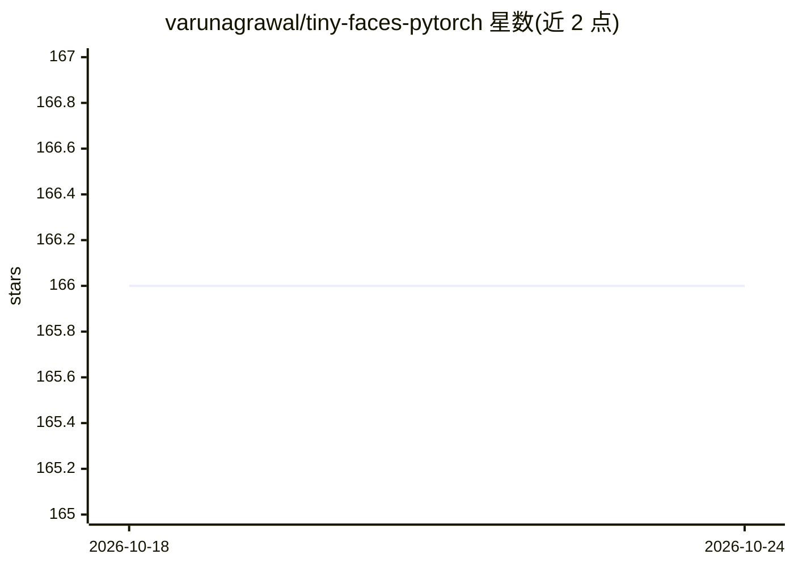

# varunagrawal/tiny-faces-pytorch

⭐ 166 · Python · MIT · 推送 2025-11-03 · [GitHub](https://github.com/varunagrawal/tiny-faces-pytorch) · 个人维护

**Peiyun Hu 小人脸检测器的 PyTorch 复现实现**

Peiyun Hu CVPR 论文 tiny face detector 的 PyTorch 实现，面向计算机视觉研究与开发者。支持在 WIDER Face 数据集上训练（make 命令）、按 WIDERFace 规范做评测与测试集推理，并提供预训练权重（hard 集 mAP 0.797）。通过 detect_image.py 脚本对自有图片执行人脸检测，可调概率与 NMS 阈值。评测生成 mAP 需要数据集的 eval_tools（Matlab/Octave）。

## 筛选速览

| 维度 | 判定 | 备注 |
|---|---|---|
| AI 角色 | `ai-native` | 本体是模型或模型工具 |
| 许可风险 | `permissive` | MIT |
| 部署形态 | `library` | 以包/库形式分发 |
| 模型依赖 | — | README 未给出锁定关系 |
| 硬件要求 | — | 无带数字的原话,不猜 |
| 安装摩擦 | `low` | 无编译、无系统依赖或容器化 |
| 成熟度 | — | 结构信号不足 |

## 能力要点

- WIDER Face 数据集上 easy/medium/hard mAP 分别为 0.902/0.892/0.797
- 提供预训练权重
- Makefile 驱动训练、评测与测试集推理
- detect_image.py 支持对自有图片检测，可调概率与 NMS 阈值

## 适用场景

- 在小尺度人脸场景下运行人脸检测
- 在 WIDER Face 上复现训练与评测结果
- 基于预训练权重对自有图片做推理

## 场景标签

 · 领域:计算机视觉/人脸检测

## 证据(README 行号)

> L3: This is a PyTorch implementation of Peiyun Hu's awesome tiny face detector.
> L52: To run the model on your own image, please use the `detect_image.py` script.

## 星数曲线

2026-10-18 166 → 2026-10-24 166（+0）

---
*卡片 v1 · prompt 1.4 · 生成 2026-10-22 · 置信度 mid · 依据 README sha `ae2e27059e7d` · [字段定义](../../DATASET.md)*
