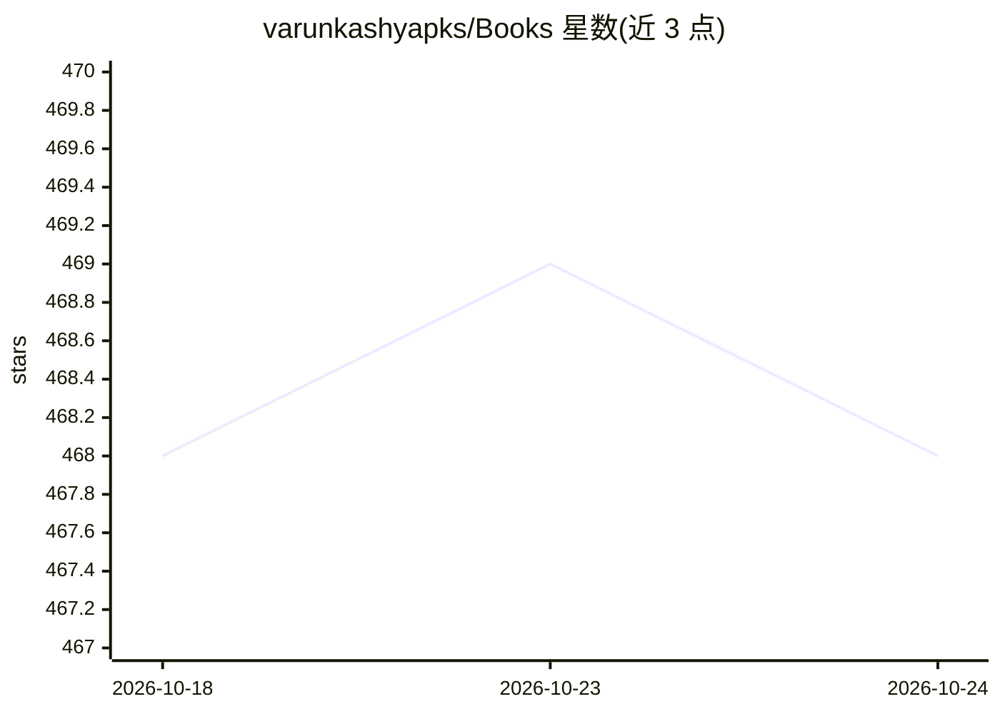

# varunkashyapks/Books

⭐ 468 · 推送 2026-08-06 · [GitHub](https://github.com/varunkashyapks/Books) · 个人维护

**AI/ML/数据科学相关书籍与课程的学习资源清单**

个人维护的电子书与在线课程参考合集，按统计学、数据科学、数据分析、数据挖掘、机器学习、信息检索、数据可视化与在线课程等类别组织，收录《Deep Learning》《The Elements of Statistical Learning》等书目及 Coursera/Udacity 课程链接，服务小项目与考试的参考资料需求。README 声明后续将补充 Docker、Kubernetes、AWS、云相关书籍。仓库仅提供清单文本，不含可运行的代码或数据。

## 筛选速览

| 维度 | 判定 | 备注 |
|---|---|---|
| AI 角色 | `ai-knowledge` | 知识聚合/清单类 |
| 许可风险 | `none` | — |
| 部署形态 | `None` |  |
| 模型依赖 | — | README 未给出锁定关系 |
| 硬件要求 | — | 无带数字的原话,不猜 |
| 安装摩擦 | `low` | 无编译、无系统依赖或容器化 |
| 成熟度 | — | 结构信号不足 |

## 能力要点

- 按 8 个左右主题类别组织书籍条目
- 覆盖统计、数据挖掘、机器学习、深度学习与 NLP 等方向
- 收录 Coursera/Udacity 等在线课程资源

## 适用场景

- 查找数据科学与机器学习领域的参考书目
- 备考或做课程项目时寻找参考资料
- 了解 NLP、信息检索、数据可视化方向的经典教材

## 场景标签

 · 领域:数据科学/教育资料

## 证据(README 行号)

> L1: ## Reference for the mini-projects and exams
> L8:  Books related to AI/ML/DL/GENAI

## 星数曲线

2026-10-18 468 → 2026-10-24 468（+0）

---
*卡片 v1 · prompt 1.4 · 生成 2026-10-21 · 置信度 high · 依据 README sha `c04854382114` · [字段定义](../../DATASET.md)*
