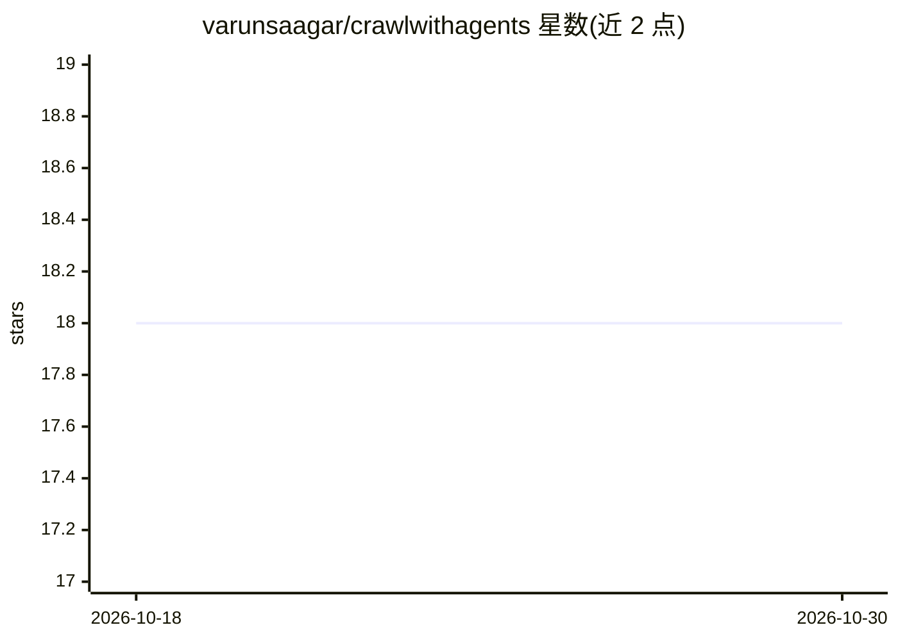

# varunsaagar/crawlwithagents

⭐ 18 · Python · 推送 2026-10-29 · [GitHub](https://github.com/varunsaagar/crawlwithagents) · 个人维护

**用 Ollama+Crawl4AI 从网页抽取并分析元数据的工具集**

提供三个命令行工具：WebScraperTool 用 crawl4ai 抓取网页并抽取标题、描述和关键词，DataCleanerTool 清洗格式化原始元数据，MetadataAnalyzerTool 分析清洗后数据给出标题长度、描述长度与关键词分析等 SEO 洞察。运行依赖 Ollama 与 qwen2:1.5b 模型及 praisonai_tools。安装方式为克隆仓库、创建虚拟环境后 pip 安装依赖并运行 Python 脚本，需 Python 3.10+。

## 筛选速览

| 维度 | 判定 | 备注 |
|---|---|---|
| AI 角色 | `ai-ecosystem` | LLM/agent 周边工具 |
| 许可风险 | `none` | — |
| 部署形态 | `library` | 以包/库形式分发 |
| 模型依赖 | local-ok | 支持本地模型 |
| 硬件要求 | — | 无带数字的原话,不猜 |
| 安装摩擦 | `low` | 无编译、无系统依赖或容器化 |
| 成熟度 | — | 结构信号不足 |

## 能力要点

- 三工具流水线：抓取→清洗→分析元数据
- crawl4ai 多 agent 内容抽取
- 基于 Ollama 运行 qwen2:1.5b 模型
- 输出标题/描述长度与关键词分析

## 适用场景

- 批量抽取网站的标题、描述与关键词
- 清洗网页抓取得到的原始元数据
- 分析站点元数据获取 SEO 洞察

## 场景标签

`网页抓取` · 领域:效率与自动化

## 证据(README 行号)

> L3: This project provides tools for web scraping, data cleaning, and metadata analysis using Ollama with qwen2:1.5b and 
> L7: - Web scraping with crawl4ai using multiagent agents for content extraction
> L23: - ollama

## 星数曲线

2026-10-18 18 → 2026-10-30 18（+0）

---
*卡片 v1 · prompt 1.4 · 生成 2026-10-29 · 置信度 mid · 依据 README sha `f76901f685b3` · [字段定义](../../DATASET.md)*
