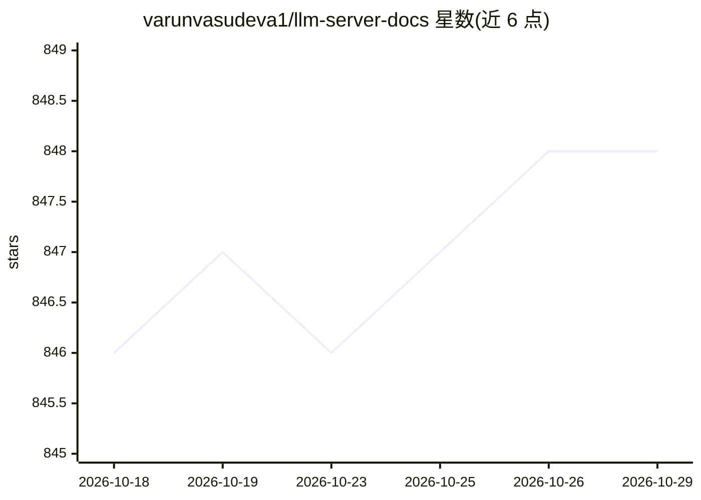

# varunvasudeva1/llm-server-docs

⭐ 848 · MIT · 推送 2026-06-30 · [GitHub](https://github.com/varunvasudeva1/llm-server-docs) · 个人维护

**Debian 本地私有 LLM 服务器的端到端搭建教程文档**

面向 Linux 初学者的教程仓库：在 Debian 上从零搭建本地、完全私有的 LLM 服务器。覆盖 GPU 驱动与功耗限制、开机脚本、Docker 安装，以及推理引擎（Ollama/llama.cpp/vLLM）、Open WebUI 聊天平台、SearXNG 搜索、llama-swap 模型管理、MCP 代理（mcp-proxy/MCPJungle）、Kokoro TTS、ComfyUI 图像生成与 Tailscale 远程访问等组件的配置。仓库本身为文档，不含可运行产品代码，各组件安装命令均为第三方软件。

## 筛选速览

| 维度 | 判定 | 备注 |
|---|---|---|
| AI 角色 | `ai-knowledge` | 知识聚合/清单类 |
| 许可风险 | `permissive` | MIT |
| 部署形态 | `self-host` | docker 或自建部署 |
| 模型依赖 | — | README 未给出锁定关系 |
| 硬件要求 | — | 无带数字的原话,不猜 |
| 安装摩擦 | `low` | 无编译、无系统依赖或容器化 |
| 成熟度 | — | 结构信号不足 |

## 能力要点

- 端到端覆盖驱动、安全、容器化与完整软件栈配置
- 推理引擎支持 Ollama / llama.cpp / vLLM，组件可替换
- 含 GPU 功耗限制与开机自启动脚本（init.bash）配置
- 明确标注作者参考硬件（2x RTX 3090 / 96GB 内存）并说明 AMD 与 CPU-only 路径

## 适用场景

- 首次搭建家用 LLM 服务器需要逐步指引
- 想在内网自建带聊天、搜索、RAG、图像生成与 TTS 的私有服务
- 为 24/7 运行的推理服务器做功耗与开机自动化配置

## 场景标签

`教程课程` · 领域:学习与行业

## 证据(README 行号)

> L3: _TL;DR_: End-to-end documentation to set up your own local & fully private LLM server on Debian. Equipped with chat,
> L7: - Inference Engine (Ollama, llama.cpp, vLLM)
> L24: This repository outlines the steps to run a server for running local language models. It uses Debian specifically, 

## 星数曲线

2026-10-18 846 → 2026-10-29 848（+2）

---
*卡片 v1 · prompt 1.4 · 生成 2026-10-21 · 置信度 mid · 依据 README sha `e8041580209b` · [字段定义](../../DATASET.md)*
