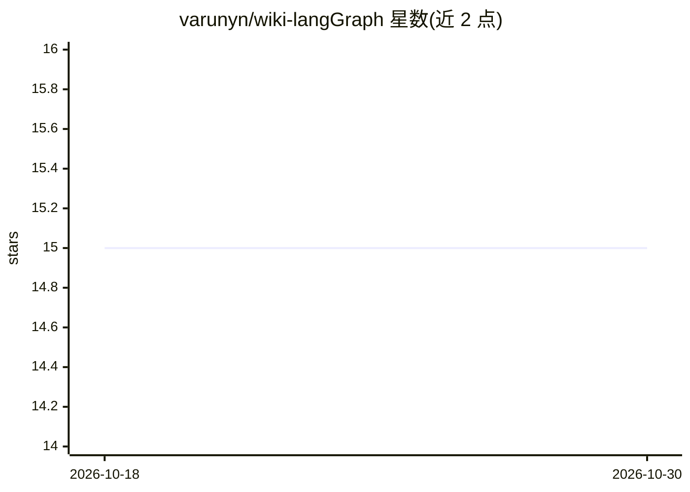

# varunyn/wiki-langGraph

⭐ 15 · Python · MIT · 推送 2026-09-22 · [GitHub](https://github.com/varunyn/wiki-langGraph) · 个人维护

**把 Markdown 笔记编译为带链接 wiki 的 LangGraph 管线，AI 功能可选**

Python 3.12+ 的 LangGraph 流水线：递归读取 data/raw/ 下的 .md 文件，编译为带 frontmatter、wikilinks、backlinks 和 index.md 的链接式 wiki，默认输出 OKF 格式、可在 Obsidian 打开。基础编译路径确定性，不依赖 LLM。可选功能包括：通过 OpenAI 兼容端点做笔记写作、查询与研究简报、语义 See also 链接，以及 QMD 本地索引刷新与检索。提供 lint（未解析链接、孤儿笔记、输出过期等）与修复、AI 候选人工审核、只读知识缺口审查。使用 uv 安装运行。

## 筛选速览

| 维度 | 判定 | 备注 |
|---|---|---|
| AI 角色 | `ai-enhanced` | 去掉 AI 部分产品仍成立 |
| 许可风险 | `permissive` | MIT |
| 部署形态 | `None` |  |
| 模型依赖 | local-ok | 支持本地模型 |
| 硬件要求 | — | 无带数字的原话,不猜 |
| 安装摩擦 | `low` | 无编译、无系统依赖或容器化 |
| 成熟度 | — | 结构信号不足 |

## 能力要点

- 确定性编译路径：frontmatter、backlinks、index.md，无需 LLM 或 QMD
- 可选 OpenAI 兼容端点的 LLM 写作、query/research 与语义 See also 链接
- lint 检查未解析 wikilink、孤儿笔记、index 漂移并提供 --fix 修复
- AI 生成候选可排队人工审核（review list/show/approve/reject）

## 适用场景

- 把散落的 Markdown 笔记编译成可导航的 Obsidian 兼容 wiki
- 在编译后的 wiki 上做带出处的查询与研究并保存回笔记库
- 审查知识库中的断链、孤儿笔记与概念缺口

## 场景标签

`知识库管理` `RAG` · 领域:知识与检索

## 证据(README 行号)

> L3: `wiki-langgraph` turns a folder of Markdown notes into a linked, searchable

## 星数曲线

2026-10-18 15 → 2026-10-30 15（+0）

---
*卡片 v1 · prompt 1.4 · 生成 2026-10-30 · 置信度 high · 依据 README sha `875792ec250c` · [字段定义](../../DATASET.md)*
