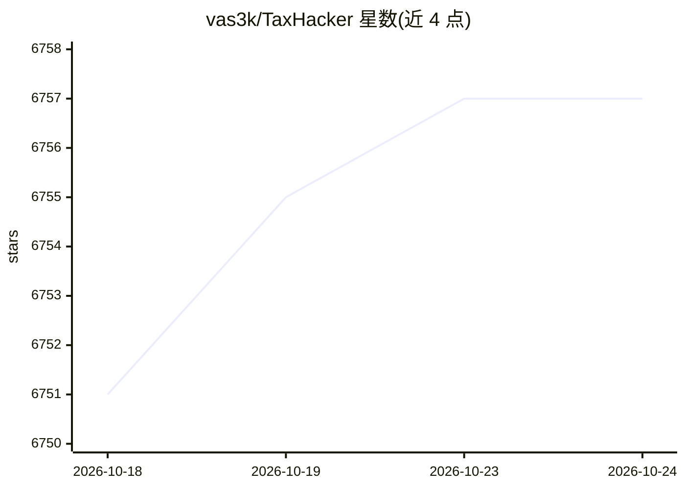

# vas3k/TaxHacker

⭐ 6,757 · TypeScript · MIT · 推送 2026-09-28 · [GitHub](https://github.com/vas3k/TaxHacker) · [官网](https://taxhacker.app) · 个人维护

**自托管 AI 记账应用：自动识别收据发票并提取结构化数据**

面向自由职业者、独立开发者和小微企业的自托管记账 Web 应用：上传收据照片、发票或 PDF，由 LLM 自动识别并提取日期、金额、商户、行项目、税额等字段存入结构化数据库，可自定义字段与提取 prompt，支持自动分类、多项目、全文检索和 CSV 导出。支持 OpenAI、Gemini、Mistral 及任何 OpenAI 兼容的本地 LLM 端点（Ollama、LM Studio、vLLM、LocalAI）。内置 170+ 法币与 14 种加密货币的历史汇率自动换算。提供 Docker Compose 部署，README 声明项目仍处早期开发阶段。

## 筛选速览

| 维度 | 判定 | 备注 |
|---|---|---|
| AI 角色 | `ai-native` | 本体是模型或模型工具 |
| 许可风险 | `permissive` | MIT |
| 部署形态 | `self-host` | docker 或自建部署 |
| 模型依赖 | local-ok | 支持本地模型 |
| 硬件要求 | — | 无带数字的原话,不猜 |
| 安装摩擦 | `low` | 无编译、无系统依赖或容器化 |
| 成熟度 | `idea` | |

## 能力要点

- LLM 识别收据/发票/PDF 并提取结构化记账数据
- 可自定义字段、类别与 LLM prompt（含系统 prompt）
- 支持 OpenAI/Gemini/Mistral 及 OpenAI 兼容本地 LLM（Ollama、vLLM 等）
- 170+ 法币与 14 种加密货币按交易日历史汇率自动换算

## 适用场景

- 拍摄收据或上传发票自动记账，省去手工录入
- 把交易按自定义类别、项目整理并导出给会计师报税
- 在自有服务器上托管，掌控财务数据隐私
- 用自选的本地 LLM 处理敏感票据数据

## 场景标签

`文档解析` · 领域:知识与检索

## 证据(README 行号)

> L10: TaxHacker is a self-hosted accounting app designed for freelancers, indie-hackers, and small businesses who want to
> L12: Upload photos of receipts, invoices, or PDFs, and TaxHacker will automatically recognize and extract all the import
> L30: Snap a photo of any receipt or upload an invoice PDF, and TaxHacker will automatically recognize, extract, categori

## 星数曲线

2026-10-18 6,751 → 2026-10-24 6,757（+6）

---
*卡片 v1 · prompt 1.4 · 生成 2026-10-20 · 置信度 high · 依据 README sha `da60547e7570` · [字段定义](../../DATASET.md)*
