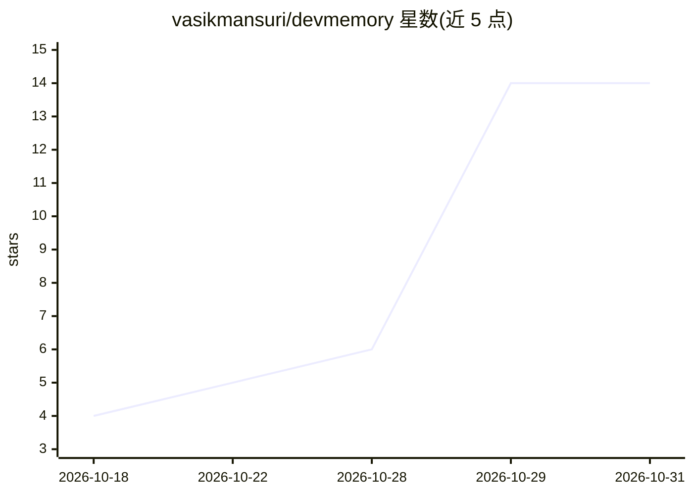

# vasikmansuri/devmemory

⭐ 14 · TypeScript · MIT · 推送 2026-10-29 · [GitHub](https://github.com/vasikmansuri/devmemory) · [官网](https://www.npmjs.com/package/@vasikmansuri/devmemory) · 个人维护

**给 AI 编程 agent 的本地持久记忆：MCP 服务器 + CLI**

面向 Claude Code、Cursor 等 MCP 客户端的本地优先记忆层：把项目决策、架构、调试经验、约定等存入 ~/.devmemory 下的单个 SQLite 文件，跨会话自动检索。提供 9 个 MCP 工具（stdio）与 15 个 CLI 命令；搜索基于 SQLite FTS5 关键词检索加 BM25 排序（按重要性/置信度/新近度加权），非语义搜索，改述问题可能漏检。存储前对 API key、token 等做密钥脱敏，项目间隔离，检索内容按不可信数据处理。需 Node.js ≥ 22.12，npm 全局安装或源码构建；Cursor 集成端到端未验证。

## 筛选速览

| 维度 | 判定 | 备注 |
|---|---|---|
| AI 角色 | `ai-ecosystem` | LLM/agent 周边工具 |
| 许可风险 | `permissive` | MIT |
| 部署形态 | `library` | 以包/库形式分发 |
| 模型依赖 | — | README 未给出锁定关系 |
| 硬件要求 | — | 无带数字的原话,不猜 |
| 安装摩擦 | `low` | 无编译、无系统依赖或容器化 |
| 成熟度 | — | 结构信号不足 |

## 能力要点

- 9 个 MCP 工具（stdio）+ 15 个 CLI 命令，JSON 输出与语义化退出码
- SQLite FTS5 + BM25 关键词检索，结果附评分解释；非语义搜索
- 存储前密钥脱敏、项目隔离、检索内容按不可信数据包装
- 本地单文件存储，无遥测、无网络监听；JSON 导入导出

## 适用场景

- 让 Claude Code 记住项目决策与调试经验，新会话免重复解释
- 团队通过 .mcp.json 共享 MCP 记忆服务器配置
- 用 CLI 在脚本/自动化中检索与管理系统记忆

## 场景标签

`Agent 记忆` · 领域:Agent 开发

## 证据(README 行号)

> L3: ### Persistent, local-first memory for AI coding agents. An MCP server and CLI for Claude Code, Cursor and other MCP
> L34: - 🔌 **MCP server.** 9 tools over stdio, verified with **Claude Code**. Works with any MCP client.
> L88: claude mcp add --transport stdio devmemory -- devmemory mcp

## 星数曲线

2026-10-18 4 → 2026-10-31 14（+10）

---
*卡片 v1 · prompt 1.4 · 生成 2026-10-31 · 置信度 high · 依据 README sha `61d754671640` · [字段定义](../../DATASET.md)*
