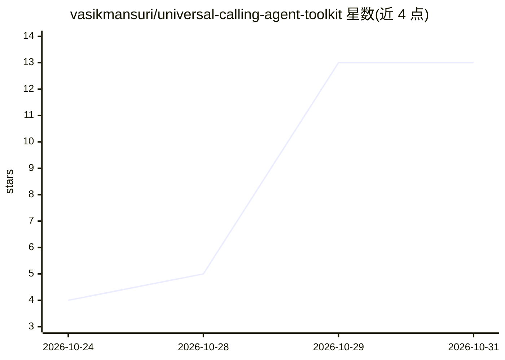

# vasikmansuri/universal-calling-agent-toolkit

⭐ 13 · Python · Apache-2.0 · 推送 2026-10-24 · [GitHub](https://github.com/vasikmansuri/universal-calling-agent-toolkit) · 个人维护

**语音通话 agent 的提供商中立工具包：电话适配、音频管线、邮箱捕获、STT 与 RAG**

面向已有 AI 通话 agent 开发者的工具库，提供 Twilio/Plivo/Telnyx/Vonage 电话适配器及 RTP/SIP、WebSocket、WAV 输入，统一音频管线（G.711 解码、重采样、可插拔降噪）、防误拼写的邮箱捕获、STT 转写事件整合（含 Deepgram 适配器）与带租户/ACL 控制的 RAG 组件。TypeScript 与 Python 双实现共享 JSON Schema 契约，声明零运行时依赖。尚未发布到 npm/PyPI，需从仓库安装；电话适配器为 fixture 测试，未对真实账户验证。

## 筛选速览

| 维度 | 判定 | 备注 |
|---|---|---|
| AI 角色 | `ai-ecosystem` | LLM/agent 周边工具 |
| 许可风险 | `permissive` | Apache-2.0 |
| 部署形态 | `library` | 以包/库形式分发 |
| 模型依赖 | — | README 未给出锁定关系 |
| 硬件要求 | — | 无带数字的原话,不猜 |
| 安装摩擦 | `low` | 无编译、无系统依赖或容器化 |
| 成熟度 | `idea` | |

## 能力要点

- 4 家电话提供商适配器 + RTP/SIP/WebSocket/WAV 多种输入
- TypeScript 与 Python 双实现共享 JSON Schema 契约与测试夹具
- STT 转写整合（Deepgram 适配器）与安全 RAG（租户/ACL、引用、超时）
- 邮箱捕获支持拼写、逐字母、拒绝后补录等状态机处理

## 适用场景

- 给已有的 LLM 语音通话 agent 接入电话提供商而不更换技术栈
- 统一多家电话平台的音频处理与转写事件流
- 在通话中可靠捕获并确认客户邮箱地址
- 为语音 agent 添加带访问控制的 RAG 问答

## 场景标签

`语音 Agent` `RAG` `语音识别` · 领域:对话与助手

## 证据(README 行号)

> L11:  Plug reliable telephony, clean audio, email capture, speech-to-text and RAG into the AI calling agent you already 
> L27: This toolkit fixes both **without replacing your stack**. Your LLM, prompts and call flow stay yours. You get small
> L63: Each box is independent: use the email capture alone, or the adapters alone. The toolkit never opens servers or pic

## 星数曲线

2026-10-24 4 → 2026-10-31 13（+9）

---
*卡片 v1 · prompt 1.4 · 生成 2026-10-31 · 置信度 mid · 依据 README sha `6c7f95e4f09f` · [字段定义](../../DATASET.md)*
