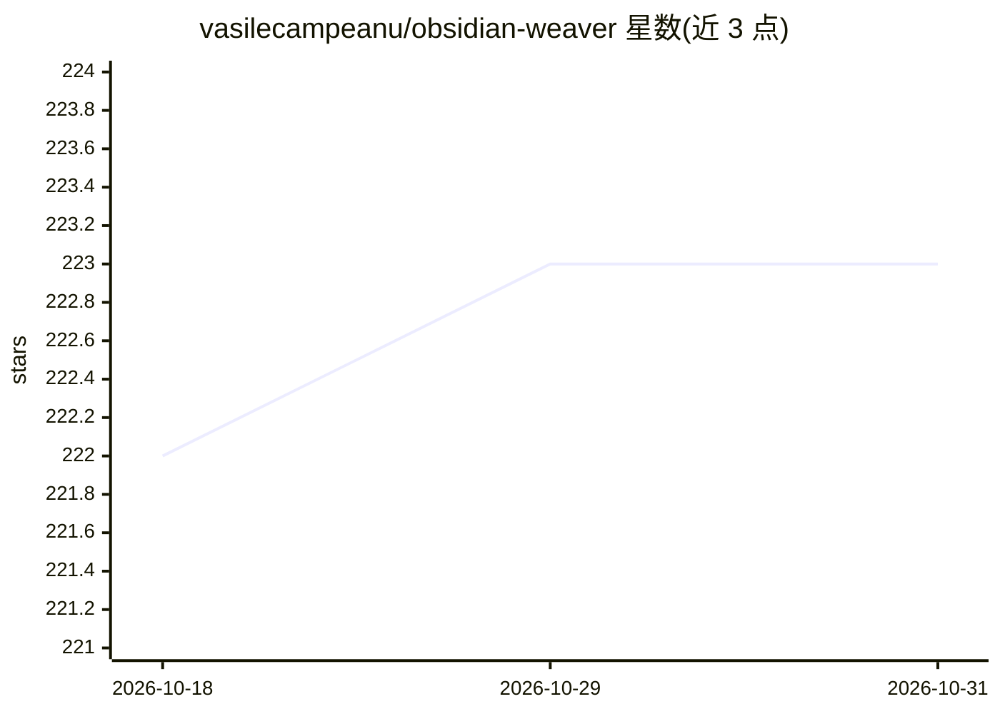

# vasilecampeanu/obsidian-weaver

⭐ 223 · TypeScript · MIT · 推送 2026-08-13 · [GitHub](https://github.com/vasilecampeanu/obsidian-weaver) · 个人维护

**Obsidian 笔记内嵌 ChatGPT 式 AI 对话插件**

Weaver 是一个 Obsidian 插件，在笔记工作流中嵌入类 ChatGPT 的聊天界面，用于在 Obsidian 内直接与 AI 助手对话，获取写作建议与头脑风暴支持。支持创建与管理多个会话、切换模型、重新生成消息、编辑历史用户消息，以及在不同分支消息间导航。尚未上架官方插件库，可通过 obsidian42-brat 社区插件或手动下载 release 文件（main.js、manifest.json、styles.css）安装。

## 筛选速览

| 维度 | 判定 | 备注 |
|---|---|---|
| AI 角色 | `ai-enhanced` | 去掉 AI 部分产品仍成立 |
| 许可风险 | `permissive` | MIT |
| 部署形态 | `None` |  |
| 模型依赖 | — | README 未给出锁定关系 |
| 硬件要求 | — | 无带数字的原话,不猜 |
| 安装摩擦 | `low` | 无编译、无系统依赖或容器化 |
| 成熟度 | `idea` | |

## 能力要点

- 在 Obsidian 内直接与 AI 助手对话的聊天界面
- 会话管理：新建、切换、重新生成与编辑历史消息
- 分支消息导航，可探索对话的不同路径
- 支持切换模型

## 适用场景

- 在笔记中直接询问 AI 获取写作建议
- 边记笔记边与 AI 助手头脑风暴
- 通过分支对话探索同一问题的多种回答路径

## 场景标签

`聊天机器人` `AI 助手` · 领域:对话与助手

## 证据(README 行号)

> L5: Weaver is an Obsidian plugin that integrates a ChatGPT-like interface into your note-taking workflow. This plugin ma
> L9: - **Chat Interface with AI Assistants**: Communicate with AI assistants through a chat-like interface directly withi

## 星数曲线

2026-10-18 222 → 2026-10-31 223（+1）

---
*卡片 v1 · prompt 1.4 · 生成 2026-10-22 · 置信度 high · 依据 README sha `5819895655c1` · [字段定义](../../DATASET.md)*
