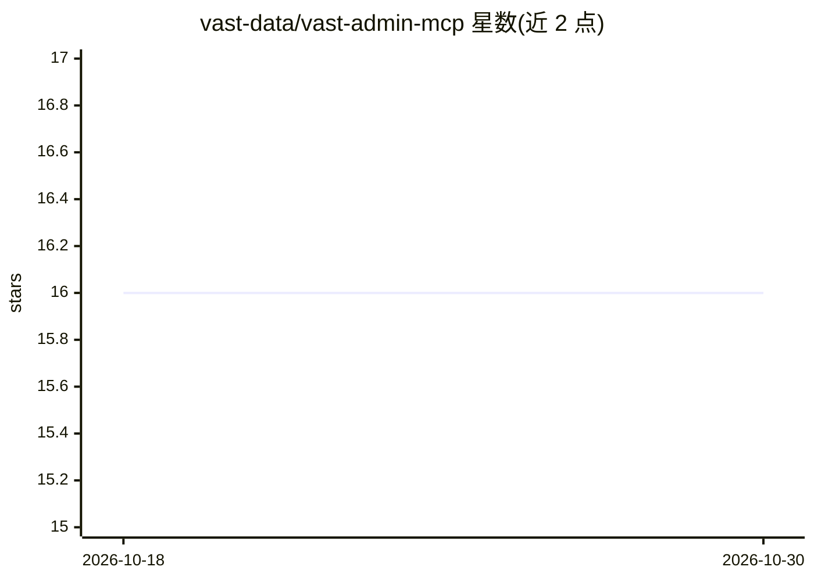

# vast-data/vast-admin-mcp

⭐ 16 · Python · NOASSERTION · 推送 2026-10-07 · [GitHub](https://github.com/vast-data/vast-admin-mcp) · [官网](https://pypi.org/project/vast-admin-mcp/) · 组织维护

**面向 VAST Data 集群管理的 MCP 服务器，供 AI 助手调用**

实现 Model Context Protocol 的服务器，为 AI 助手提供与 VAST 存储集群交互的工具：静态列表工具（集群状态、性能指标、用户查询）与基于 YAML 模板自动生成的动态列表工具；以 --read-write 启动后可创建 view、快照与克隆。支持 stdio 与 HTTP 传输，HTTP 模式提供 Bearer token 与 OAuth/OIDC 认证、SSL/TLS、Kubernetes/OpenShift 部署清单，凭据可经 keyring 或 K8s Secrets 存储。同时提供独立 CLI。面向集群与租户管理员使用，需 Python 3.10+ 与 jq。

## 筛选速览

| 维度 | 判定 | 备注 |
|---|---|---|
| AI 角色 | `ai-ecosystem` | LLM/agent 周边工具 |
| 许可风险 | `none` | NOASSERTION |
| 部署形态 | `self-host` | docker 或自建部署 |
| 模型依赖 | — | README 未给出锁定关系 |
| 硬件要求 | — | 无带数字的原话,不猜 |
| 安装摩擦 | `low` | 无编译、无系统依赖或容器化 |
| 成熟度 | — | 结构信号不足 |

## 能力要点

- MCP 工具覆盖集群列表、性能指标与用户查询
- YAML 模板自动注册动态列表工具，支持用户修改
- HTTP 传输 + Bearer/OAuth/OIDC 认证 + SSL/TLS
- 提供 Docker 构建脚本与 Kubernetes/OpenShift 部署清单，凭据支持 K8s Secrets

## 适用场景

- 让 Claude Desktop/Cursor 等 AI 助手查看 VAST 集群状态与性能
- 通过 AI 助手创建 NFS/S3 视图、快照与克隆（read-write 模式）
- 在 Kubernetes/OpenShift 环境以 HTTP 方式远程接入 MCP 服务器

## 场景标签

 · 领域:存储基础设施管理/AI 工具集成

## 证据(README 行号)

> L8: VAST Admin MCP Server is a Model Context Protocol (MCP) server for VAST Data administration tasks. It provides AI as
> L14: - **MCP Integration**: Full MCP server implementation for AI assistant integration

## 星数曲线

2026-10-18 16 → 2026-10-30 16（+0）

---
*卡片 v1 · prompt 1.4 · 生成 2026-10-30 · 置信度 high · 依据 README sha `a802d0739255` · [字段定义](../../DATASET.md)*
