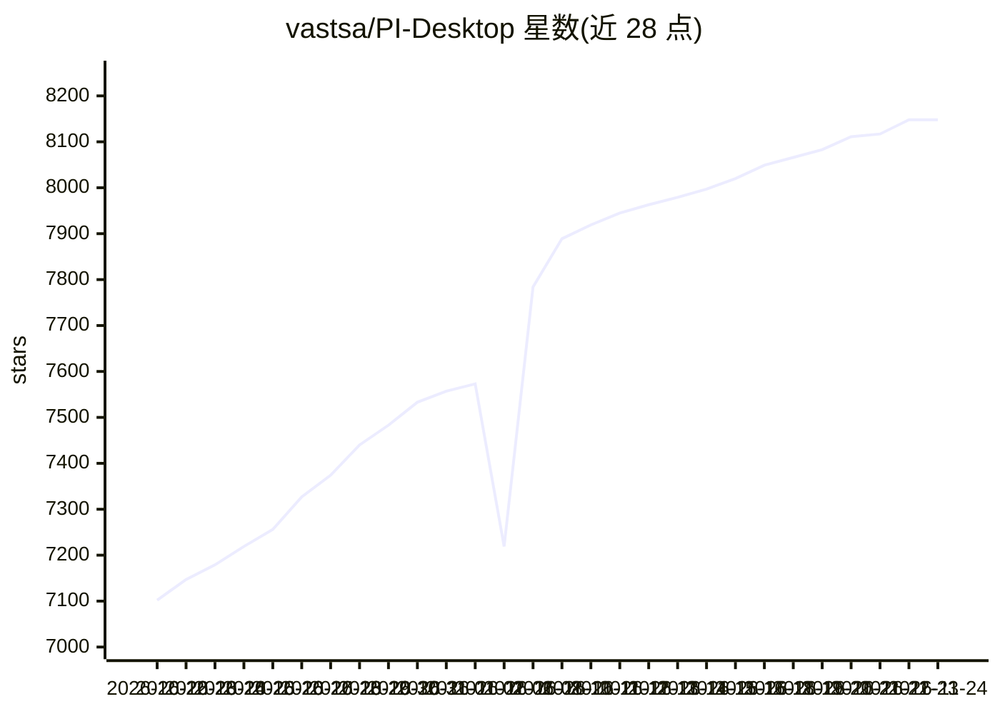

# vastsa/PI-Desktop

⭐ 8,148 · TypeScript · LGPL-3.0 · 推送 2026-11-22 · [GitHub](https://github.com/vastsa/PI-Desktop) · [官网](https://www.aiuo.net) · 组织维护 · 中文 README

**给 AI 编码 agent 提供持久化桌面工作区的平台**

基于 Electron + Rust host core 与 pi 生态（pi-ai/pi-agent-core/pi-coding-agent）构建的桌面应用，把项目、会话、模型、插件整合进本地工作区。提供 Agent/Plan/Goal 三种工作模式、Subagent 与 Worker Session 两级委派编排、权限控制层、插件系统（命令/面板/Agent 工具/MCP 服务器/主题等 12 类扩展点）与插件市场。数据默认本地存储，API 凭据存 OS Keychain，无强制账号；macOS/Windows/Linux 提供安装包，支持从源码运行（Node.js/pnpm/Rust）。

## 筛选速览

| 维度 | 判定 | 备注 |
|---|---|---|
| AI 角色 | `ai-ecosystem` | LLM/agent 周边工具 |
| 许可风险 | `viral` | LGPL-3.0 |
| 部署形态 | `desktop` | 安装包/桌面程序 |
| 模型依赖 | local-ok | 支持本地模型 |
| 硬件要求 | — | 无带数字的原话,不猜 |
| 安装摩擦 | `low` | 无编译、无系统依赖或容器化 |
| 成熟度 | — | 结构信号不足 |

## 能力要点

- Subagent 与 Worker Session 两级 agent 编排，Worker 可独立上下文执行
- 插件系统覆盖命令、面板、Agent 工具、MCP 服务器、后台服务等扩展点
- 模型可替换：云模型、兼容 API、自定义网关、Ollama/LM Studio 本地模型
- 可导入 Claude Code/Codex/OpenCode/Pi 的本地会话

## 适用场景

- 在独立于 IDE/终端的桌面环境中运行编码 agent
- 将复杂任务拆分给多个并行 agent 会话协作
- 配置本地模型做私密任务的 agent 开发
- 作为宿主平台开发 agent 插件与 MCP 服务器

## 场景标签

`编码 Agent` `Agent 框架` · 领域:Agent 开发

## 证据(README 行号)

> L36: > **Give AI agents a persistent, independent, and extensible desktop workspace of their own.**
> L382: ## Built on Pi
> L392: > **Pi provides the Agent Engine. PI-Desktop builds the persistent desktop workspace, sessions, permissions, plugi

## 星数曲线

2026-10-22 7,102 → 2026-11-24 8,148（+1,046）

---
*卡片 v1 · prompt 1.4 · 生成 2026-11-22 · 置信度 high · 依据 README sha `a67521246c4f` · [字段定义](../../DATASET.md)*
