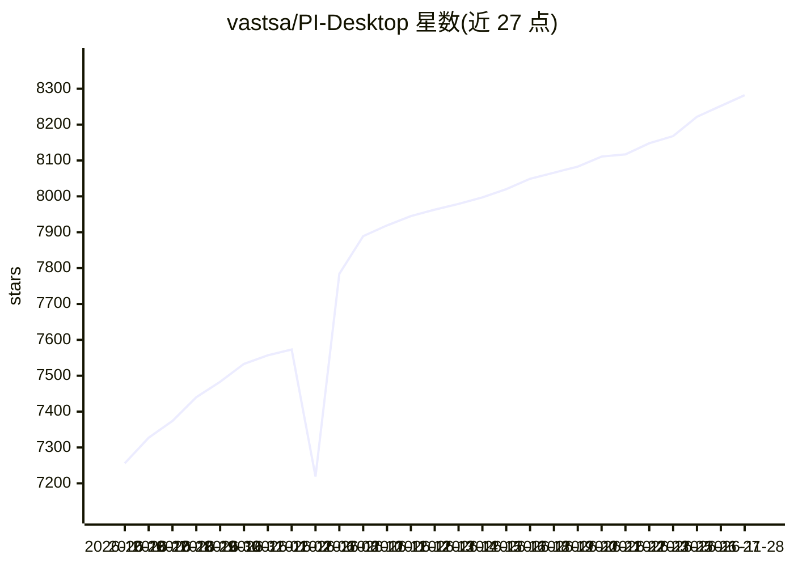

# vastsa/PI-Desktop

⭐ 8,282 · TypeScript · LGPL-3.0 · 推送 2026-11-27 · [GitHub](https://github.com/vastsa/PI-Desktop) · [官网](https://www.aiuo.net) · 组织维护 · 中文 README

**面向开发者的本地优先 AI Agent 桌面工作区**

基于 Electron 与 Rust 主机核心的桌面应用，围绕 pi 生态（pi-ai、pi-agent-core、pi-coding-agent）构建持久化的 Agent 工作区：项目/会话管理、Agent/Plan/Goal 三种工作模式、子代理与 Worker Session 编排、权限层、插件系统（面板/组件/MCP 服务器/后台服务等 10 类扩展能力）与插件市场。模型可配置为云服务、OpenAI 兼容 API、自定义网关或本地模型，数据默认本地存储，支持局域网 WebUI 从手机继续会话。

## 筛选速览

| 维度 | 判定 | 备注 |
|---|---|---|
| AI 角色 | `ai-ecosystem` | LLM/agent 周边工具 |
| 许可风险 | `viral` | LGPL-3.0 |
| 部署形态 | `desktop` | 安装包/桌面程序 |
| 模型依赖 | local-ok | 支持本地模型 |
| 硬件要求 | — | 无带数字的原话,不猜 |
| 安装摩擦 | `low` | 无编译、无系统依赖或容器化 |
| 成熟度 | — | 结构信号不足 |

## 能力要点

- 插件系统覆盖 Agent 工具、面板、浮动组件、MCP 服务器、后台服务等扩展点，可打包为 .piplug 或经市场安装
- 子代理与 Session Orchestrator 两级委派，Worker Session 具有独立上下文与完整记录
- 模型无关：支持 OpenAI/Anthropic/OpenAI 兼容 API/自定义网关/Ollama/LM Studio/本地模型，会话内可切换
- 本地优先：项目、会话、设置均本地存储，凭据存于 OS Keychain，无强制账号与中继

## 适用场景

- 在一个桌面环境中管理多个项目的 AI 编码会话与代码审查
- 通过多代理并行拆分执行复杂开发任务
- 用本地模型处理不希望发送到云端的私有任务
- 为团队搭建定制化的 Agent 工作台或开发 Agent 插件产品

## 场景标签

`编码 Agent` `代码审查` `Agent 框架` · 领域:Agent 开发

## 证据(README 行号)

> L5: ### A modular desktop workspace for AI agents
> L64: ### It is a desktop platform for agent workflows.
> L411: PI-Desktop can also serve as a host platform for building agent products.

## 星数曲线

2026-10-26 7,256 → 2026-11-28 8,282（+1,026）

---
*卡片 v1 · prompt 1.4 · 生成 2026-11-28 · 置信度 high · 依据 README sha `44a5673bad6d` · [字段定义](../../DATASET.md)*
