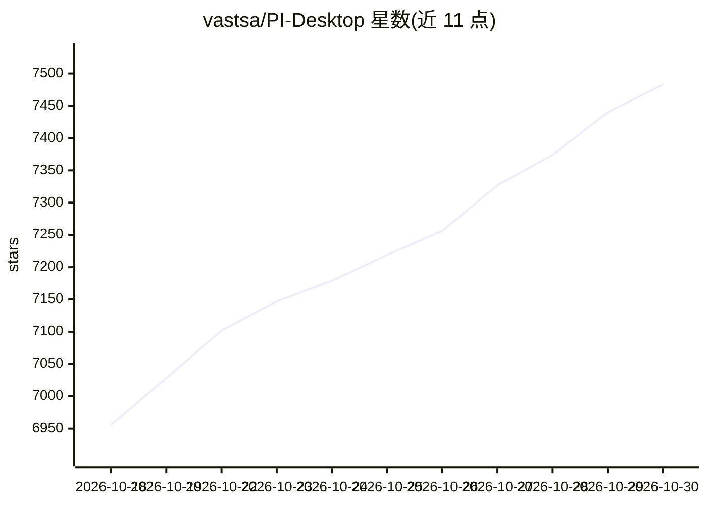

# vastsa/PI-Desktop

⭐ 7,483 · TypeScript · LGPL-3.0 · 推送 2026-10-29 · [GitHub](https://github.com/vastsa/PI-Desktop) · [官网](https://pi-docs.aiuo.net) · 个人维护 · 中文 README

**面向 AI 编码代理的本地优先模块化桌面工作区**

基于 Electron 与 Rust 宿主内核、构建于 pi 生态（pi-ai/pi-agent-core/pi-coding-agent）之上的桌面应用：为 AI 代理提供持久、独立于 IDE 与终端的工作区，含项目/会话管理、Agent/Plan/Goal 三种工作模式、Subagent 与 Worker Session 两级任务委派、权限层与插件市场（.piplug 包）。模型无关，可接入 OpenAI/Anthropic/OpenAI 兼容 API/自定义网关/Ollama/LM Studio/本地模型。当前发布线为 0.21.x Early Preview，LGPL-3.0 许可，提供 macOS/Windows/Linux 安装包。

## 筛选速览

| 维度 | 判定 | 备注 |
|---|---|---|
| AI 角色 | `ai-native` | 本体是模型或模型工具 |
| 许可风险 | `viral` | LGPL-3.0 |
| 部署形态 | `desktop` | 安装包/桌面程序 |
| 模型依赖 | local-ok | 支持本地模型 |
| 硬件要求 | — | 无带数字的原话,不猜 |
| 安装摩擦 | `low` | 无编译、无系统依赖或容器化 |
| 成熟度 | `idea` | |

## 能力要点

- Agent/Plan/Goal 三种工作模式与会话内随时切换模型
- Subagent 与 Session Orchestrator 两级多代理委派
- 插件可扩展命令、面板、Agent 工具、MCP 服务、后台服务等十余类能力
- 本地优先：项目/会话/设置默认本地存储，无强制账户与中继

## 适用场景

- 在独立桌面环境中让 AI 代理读写代码、执行命令与迭代开发
- 把复杂任务委派给多个并行 Worker Session 协作完成
- 通过插件把工作区扩展为语音代理、DevOps 控制台等形态
- 接入自己的提供商、网关或本地模型做编码工作

## 场景标签

`编码 Agent` `多智能体` · 领域:Agent 开发

## 证据(README 行号)

> L139: PI-Desktop can simply be your coding agent.
> L153: Read code, edit files, run commands, test, and iterate.
> L396: PI-Desktop can also serve as a host platform for building agent products.

## 星数曲线

2026-10-18 6,956 → 2026-10-30 7,483（+527）

---
*卡片 v1 · prompt 1.4 · 生成 2026-10-20 · 置信度 mid · 依据 README sha `c8ce0ebbd7fe` · [字段定义](../../DATASET.md)*
