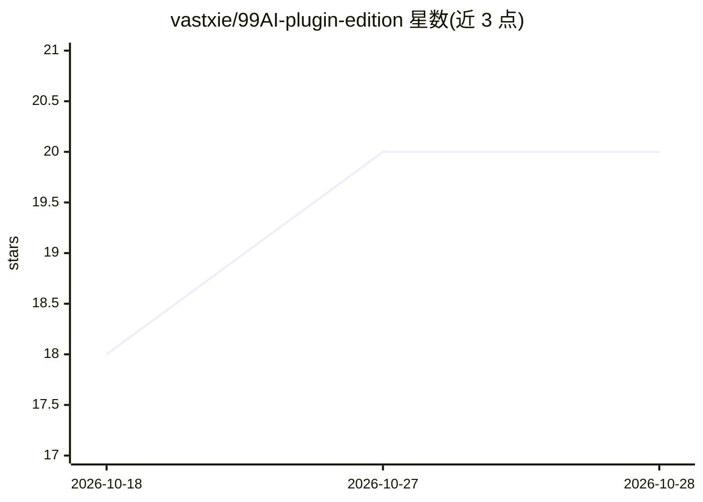

# vastxie/99AI-plugin-edition

⭐ 20 · TypeScript · Apache-2.0 · 推送 2026-10-22 · [GitHub](https://github.com/vastxie/99AI-plugin-edition) · 个人维护 · 中文 README

**自托管 AI 对话平台：聊天、插件、Agent 与运营后台一体**

未编译的开源自托管 AI Web 平台，单仓库包含 NestJS 后端、Vue 3 用户聊天端与管理端控制台，同一进程监听 9520 端口分别提供聊天与 /admin。功能覆盖多模型对话（OpenAI 兼容模型服务）、应用广场、插件、Agent 工作流编排、带权限检查的 MCP 工具接入、文件分析/联网搜索/图像视频音乐 PPT 等多模态扩展，以及用户、配额、套餐、支付、登录方式与站点外观的运营配置。运行需 MySQL、Redis 和至少一个 OpenAI 兼容模型服务；提供 Docker Compose 与一键打包脚本两条部署路径。

## 筛选速览

| 维度 | 判定 | 备注 |
|---|---|---|
| AI 角色 | `ai-native` | 本体是模型或模型工具 |
| 许可风险 | `permissive` | Apache-2.0 |
| 部署形态 | `self-host` | docker 或自建部署 |
| 模型依赖 | — | README 未给出锁定关系 |
| 硬件要求 | — | 无带数字的原话,不猜 |
| 安装摩擦 | `low` | 无编译、无系统依赖或容器化 |
| 成熟度 | — | 结构信号不足 |

## 能力要点

- 单仓库包含聊天端、管理端与 API，一个进程同时服务两个界面
- 多模型对话 + 应用广场 + 插件 + Agent 工作流编排
- MCP 工具接入，默认最小权限、按角色授权
- 运营控制台管理用户、配额、套餐/兑换码、支付与登录方式

## 适用场景

- 搭建自有域名的 AI 对话站点并对用户、配额、套餐做运营管理
- 团队需要聊天、插件、Agent 与后台管理一体的私有部署方案
- 开发者基于 NestJS + Vue 3 源码做二次开发与插件扩展

## 场景标签

`聊天机器人` `多模态` · 领域:对话与助手

## 证据(README 行号)

> L5: **A self-hosted AI web platform — chat, plugins, agents, and an ops console in one repo.**
> L18: 99AI Plugin Edition is an **uncompiled, open-source** AI service platform. People chat in the user app; admins conf
> L32: - **Multi-model chat** — context, streaming replies; model keys are entered in the admin console, not baked into th

## 星数曲线

2026-10-18 18 → 2026-10-28 20（+2）

---
*卡片 v1 · prompt 1.4 · 生成 2026-10-28 · 置信度 mid · 依据 README sha `8adf41b6fe67` · [字段定义](../../DATASET.md)*
