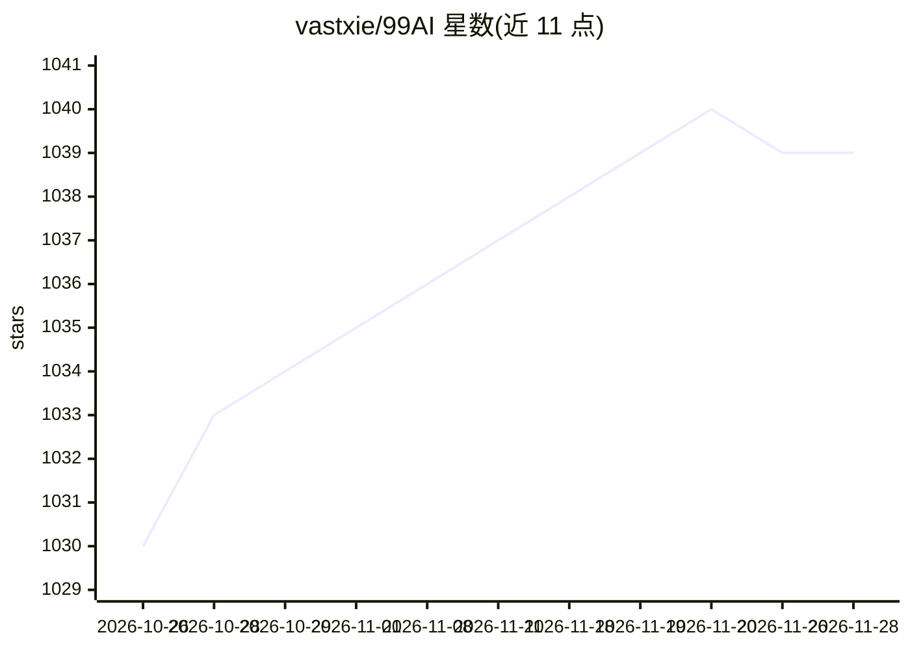

# vastxie/99AI

⭐ 1,039 · TypeScript · Apache-2.0 · 推送 2026-11-23 · [GitHub](https://github.com/vastxie/99AI) · [官网](https://agent.lightai.cloud) · 个人维护 · 中文 README

**可私有化部署的多用户 Web Agent 底座，带沙箱执行**

面向需要自托管 Agent 平台的开发者/企业：提供用户端与管理后台，任务对话中直接执行命令与处理文件，产出通过沙箱和持久工作区交付。机制上以 Docker + gVisor 实现用户隔离，支持 OpenAI 兼容接口、Anthropic、Gemini 等多模型接入，用 Skills 与 MCP 扩展能力，扩展包可按需裁剪。技术栈为 NestJS 后端 + Vue 3 前端，依赖 MySQL 与 Redis。当前为 0.1.0 测试版，接口与数据结构在 1.0 前可能调整，且与旧版不兼容。

## 筛选速览

| 维度 | 判定 | 备注 |
|---|---|---|
| AI 角色 | `ai-ecosystem` | LLM/agent 周边工具 |
| 许可风险 | `permissive` | Apache-2.0 |
| 部署形态 | `None` |  |
| 模型依赖 | — | README 未给出锁定关系 |
| 硬件要求 | — | 无带数字的原话,不猜 |
| 安装摩擦 | `low` | 无编译、无系统依赖或容器化 |
| 成熟度 | `idea` | |

## 能力要点

- Docker + gVisor 隔离沙箱，执行命令与文件处理
- 登录用户持久工作区与多用户支持，访客使用临时沙箱
- 多模型接入：OpenAI 兼容接口、Responses、Anthropic、Gemini
- Skills 与 MCP 扩展机制，扩展包按需装配

## 适用场景

- 为团队或客户搭建私有化的多用户 Agent 服务
- 在浏览器对话中运行 Python/Node 任务并交付文件
- 基于 Skills 与 MCP 构建自己的 Agent 产品

## 场景标签

`AI 助手` `聊天机器人` `Agent 框架` · 领域:Agent 开发

## 证据(README 行号)

> L5: **开源、可私有化部署的 Web Agent 底座。**
> L24: - **多模型接入** — 支持 OpenAI 兼容接口、Responses、Anthropic、Gemini、OpenCode Go。
> L47: 后端使用 NestJS，用户端与管理端使用 Vue 3。你可以通过 Skills、MCP、沙箱镜像和可裁剪的扩展包构建自己的 Agent 产品。

## 星数曲线

2026-10-26 1,030 → 2026-11-28 1,039（+9）

---
*卡片 v1 · prompt 1.4 · 生成 2026-11-24 · 置信度 mid · 依据 README sha `d3fc4f724870` · [字段定义](../../DATASET.md)*
