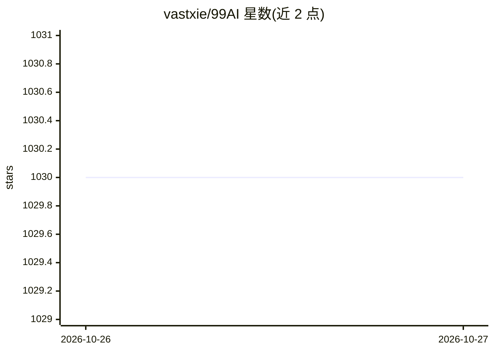

# vastxie/99AI

⭐ 1,030 · TypeScript · Apache-2.0 · 推送 2026-10-26 · [GitHub](https://github.com/vastxie/99AI) · [官网](https://agent.lightai.cloud) · 个人维护 · 中文 README

**可私有化部署的多用户 Web Agent 底座，带沙箱与后台**

开源自托管 Web Agent 平台：提供多用户任务对话（流式回复、附件上传、成果文件直接呈现）、Docker+gVisor 隔离沙箱执行命令与处理文件（支持 Python、Node 及文档/图像/音视频工具）、用户独立持久工作区。多模型接入支持 OpenAI 兼容接口、Responses、Anthropic、Gemini、OpenCode Go，并通过 Skills 与 MCP 扩展能力，模型协议/登录/存储/商业能力按包装配。技术栈为 NestJS 后端与 Vue 3 前端，需 Node.js、MySQL、Redis，生产沙箱需 Linux 与 gVisor。当前为 0.1.0 测试版，与旧版数据库不兼容。

## 筛选速览

| 维度 | 判定 | 备注 |
|---|---|---|
| AI 角色 | `ai-native` | 本体是模型或模型工具 |
| 许可风险 | `permissive` | Apache-2.0 |
| 部署形态 | `None` |  |
| 模型依赖 | — | README 未给出锁定关系 |
| 硬件要求 | — | 无带数字的原话,不猜 |
| 安装摩擦 | `low` | 无编译、无系统依赖或容器化 |
| 成熟度 | `idea` | |

## 能力要点

- 多用户任务对话与流式回复，工具过程与成果文件呈现在对话中
- Docker + gVisor 隔离沙箱，支持 Python、Node 及文档/图像/音视频工具
- 接入 OpenAI 兼容接口、Anthropic、Gemini 等多模型
- Skills 与 MCP 扩展，模型协议/登录/存储等能力按包装配

## 适用场景

- 私有化部署一个团队可用的 Web Agent 对话与任务平台
- 通过沙箱让 Agent 执行命令、处理文件并交付成果
- 以 Skills/MCP 与可裁剪扩展包构建自己的 Agent 产品

## 场景标签

`Agent 框架` · 领域:Agent 开发

## 证据(README 行号)

> L7: 从浏览器里的任务对话，到沙箱执行和文件交付。自带用户端与管理后台，接入你的模型，用 Skills 与 MCP 扩展能力。
> L21: - **任务对话** — 多用户、流式回复、附件上传，工具过程与成果文件直接呈现在对话中。
> L45: 后端使用 NestJS，用户端与管理端使用 Vue 3。你可以通过 Skills、MCP、沙箱镜像和可裁剪的扩展包构建自己的 Agent 产品。

## 星数曲线

2026-10-26 1,030 → 2026-10-27 1,030（+0）

---
*卡片 v1 · prompt 1.4 · 生成 2026-10-27 · 置信度 high · 依据 README sha `272cb2611f0c` · [字段定义](../../DATASET.md)*
